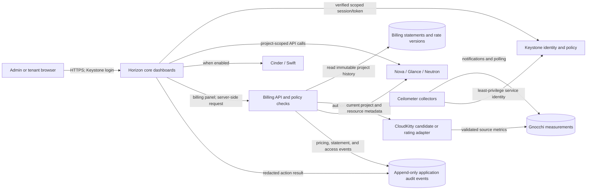

# Browser-ready OpenStack platform goal and audit

**Updated:** 2026-10-25
**Status:** Active delivery goal; not accepted
**Scope:** Local Ubuntu 22.04 / WSL2 POC first, followed by separately approved staging validation

## Goal and completion rule

Deliver a browser-ready, secure, multi-tenant self-service cloud platform. Administrators manage projects, users, roles, quotas, supported services, usage, pricing, project billing, and audit history. Tenant users see and operate only the accounts, projects, resources, usage, and bills authorized for them. Project usage is aggregated and billed at project scope by default; users in one project share its usage and bill. Payment collection and tax-compliant invoicing are separate integrations and are not claimed here.

An API library, API-only acceptance, dashboard installation, fixture success, or screenshot does not complete this goal. Backend requests must enforce scope and role checks. The end-to-end browser workflow in [T40](../tasks/T40.md) and all required service, security, billing, and recovery evidence must pass before the local POC is called complete. Staging has its own HTTPS, secrets, monitoring, security, recovery, and operator acceptance gates.

## Repository and local installation audit

### Repository evidence

At audit time, `main` was at `88fb177` and one commit ahead of `origin/main`. The worktree contained a modified `.gitignore` and untracked `.github/`, `deployment/`, and `docs/tasks/T22.md` work. These files are preserved and excluded from this task's staged changes. The repository has no local Horizon web application, billing UI, or custom management HTTP server. Existing application code is predominantly standard-library Python and has offline `unittest` coverage.

| Area | Existing evidence | Goal status |
|---|---|---|
| Real OpenStack base | Task 11 records operator-verified Keystone, Glance, Placement, Nova, Neutron, member-scoped compute lifecycle, guest networking/isolation, cleanup, recovery, and WSL restart. The retained demo VM is a protected existing resource. Current read-only unit checks show core services active and unauthenticated Apache/Keystone discovery respond HTTP 200. | Core service process state verified; authenticated cloud/guest/resource state was not checked in this audit. |
| Browser and web login | No Horizon package or Horizon process was found by the current local inventory. No custom HTTP server or web portal exists in the repository. `openstack-dashboard` is not installed; the package cache offers a Caracal candidate. | Missing. No verified dashboard URL or web login credentials exist. |
| Identity and administration | `identity.py` is a fixture-only identity provider. `RealOpenStackAdapter` checks a real project-scoped member token for a limited catalog/compute operation set. Temporary acceptance users/projects were cleaned up. | Partial: real backend scope checks exist for a narrow operation set; browser login and web administration do not. |
| Resource provisioning | `real_openstack.py` provides SDK-backed project-scoped catalog/instance operations and a durable SQLite job journal. It is a Python library, not a server or portal. The fixture management path remains simulated. | Partial: core compute has provider evidence; no complete browser resource workflow. |
| Service catalogue | Operator evidence covers Nova, Glance, Neutron and Placement. No current Cinder endpoint/backend or Swift service is established. The tracked Kolla staging example enables Horizon and disables Cinder, Swift, Ceilometer and Gnocchi. It is a template, not a deployed environment. | Core subset only. Volumes, snapshots and object storage remain service/backend-gated. |
| Console/access | Existing acceptance used an operator-managed SSH key against a private guest. The operational record says VNC/noVNC is disabled/outside that deployment slice. | No tenant browser console or user SSH workflow is verified. |
| Usage | `usage.py` defines usage records and an offline `FixtureUsageSource`; `usage_reporting.py` only emits a simulated raw summary without aggregation or rates. No Ceilometer/Gnocchi/CloudKitty package or meter source appeared in the current inventory. | Simulated only; no real usage collection. |
| Pricing and billing | The offline T31 domain now supports admin rate-card writes, Decimal rating, project statements and append-only SQLite history. It has no real meter feed, trusted Keystone adapter, HTTP endpoint, browser UI or export path. The existing usage summary remains fixture-only and has no charge. | Partial: domain behavior is unit-tested; real bills and browser integration remain pending. |
| Audit | Operational reports and cloud logs are not a user-facing audit trail for portal actions, pricing edits, or bill downloads. | Missing. |
| Security and staging | Existing code protects a narrow real member-scoped compute path and the task records describe security/recovery checks. No browser session, HTTPS portal, billing role, or full application audit boundary is implemented. Staging is unselected. | Partial locally; staging not started or approved. |

### Read-only observations from this command environment

- Ubuntu 22.04.5 LTS; 12 logical CPUs; 7.7 GiB memory total, 3.2 GiB available, 2 GiB swap; root filesystem has about 933 GiB free. These are point-in-time readings, not a capacity guarantee.
- `openstack` CLI 6.6.0 and Caracal core packages are installed. The `openstack-dashboard` package is absent; the local apt cache offers `4:24.0.1-0ubuntu0.24.04.2~cloud0`. No package was installed.
- An approved read-only host check found Apache, MariaDB, RabbitMQ, Glance API, Nova API/conductor/scheduler/compute, Neutron server/OVN metadata, and core OVN services active. This reports service-unit state only; it is not an authenticated cloud or guest health check.
- Listener ports observed were 80, 5000, 8774, 8778, 9292 and 9696. Ports 443 and 6080 were not listening. Unauthenticated GETs returned HTTP 200 for Apache `/` and Keystone `/v3/`. Apache root is not Horizon; Keystone discovery is an API response, not a browser login page. No dashboard URL or Horizon credentials exist.
- The sandbox initially hid host systemd/socket state. A specifically approved read-only host check supplied the observations above. No authenticated Keystone/Nova/Neutron request was made, no credentials/configuration contents were read, and no resource was changed. Tenant inventory, quotas, VM state, backup freshness and full policy remain unverified.
- Prior operator-supplied service and guest evidence remains recorded in [Task 11 closeout](task11-operations-and-closeout.md). It does not replace current observations. Preserve the active shared Apache server and existing OpenStack workloads when planning Horizon.
- The current WSL host has 3.2 GiB available RAM, below the separate Kolla candidate's documented 8 GiB minimum. Measure incremental Horizon/metering footprints and preserve headroom before selecting a local profile. Free disk does not resolve RAM, single-host or WSL availability limits.

## Horizon fit and custom work

| Requirement | Horizon provides when the corresponding OpenStack service and policy are configured | Additional work required here |
|---|---|---|
| Browser login and project selection | Keystone-backed dashboard login and project-scoped Project, Admin, Identity and Settings views. | Install/configure Horizon, secure browser ingress, session/CSRF settings, and role-policy checks; no login URL exists yet. |
| Users, projects, roles and quotas | Native administration panels can manage identity objects and supported service quotas. | Verify the Caracal deployment's actual policies; define an explicit admin/member/reader/billing-role matrix and test backend denials. |
| Tenant resources | Native panels cover instances, images, key pairs, networks, routers, security groups, volumes, snapshots, and object containers where enabled. | Enable only services with verified backends; test list/detail/mutation against scoped APIs. Cinder and Swift are not assumed available. |
| Resource status and access | Native resource status, task state, instance console, and SSH guidance are available for configured services. | Configure and verify noVNC or provide a safe SSH route; expose sanitized provisioning errors and retain provider evidence. Current noVNC is disabled. |
| Usage | Horizon's compute overview can show per-project instance usage summaries and CSV. It is not a full telemetry/rating/billing system. | Deploy a verified meter source and present allocation, measured consumption, freshness, and gaps separately. |
| Pricing, charges and statements | Not supplied as a complete commercial billing workflow by the core dashboard. | Build a rate administration and rating path, immutable project statement history, line-item export, and role-scoped browser panels. CloudKitty is a rating candidate, not an invoice/payment system. |
| Complete audit history | Dashboard access does not by itself establish the required retained audit record across resource actions, pricing changes and statement access. | Add a backend audit stream with actor, project, action, target, result, timestamp and correlation ID; redact credentials and sensitive payloads. |

Horizon is the selected browser surface for OpenStack-native administration and resource panels. The billing experience will be a custom Horizon/Django extension backed by a service that performs its own Keystone-derived authorization. There will be no second tenant password database. The extension must not trust hidden buttons or caller-supplied project IDs as authorization. Use the Horizon request's verified scoped identity for project access, and keep the usage collector's service identity separate from administrator and tenant credentials.

This selection follows Horizon's documented Project/Admin capabilities for instances, images, key pairs, networks, security groups, volumes, object containers, usage summaries, and administration ([Horizon user guide](https://docs.openstack.org/horizon/2024.1/user/), [Horizon administration guide](https://docs.openstack.org/horizon/2024.1/admin/)). Horizon documents a registration pattern for third-party dashboard applications and panels ([Horizon contributor documentation](https://docs.openstack.org/horizon/2024.1/contributor/)). Its built-in usage summary is useful source data, but it does not define this project's prices or issue the required billing statements.

## Supported service catalogue

| Service/capability | Initial disposition | Billable/visible data rule |
|---|---|---|
| Keystone identity/projects/roles | Core | Show only current user's profile, authorized projects and roles; admin functions require the approved admin role. Project is the billing tenant. |
| Nova compute | Core | Tenant instances, lifecycle, status/errors, and access. Initial billing candidate: active allocated vCPU-hours and GiB-RAM-hours from provider-confirmed state intervals. |
| Glance images | Core, policy-controlled | List/create/use only images visible to the project. Do not charge image storage until a verified project-attributed meter and policy exist. |
| Neutron networks/security groups/key pairs | Core | Project-scoped resources and quotas. Show network/traffic charges only when a real meter and attribution are verified. |
| Browser console or SSH | Required access path | Prefer a verified noVNC console when configured; otherwise document and test the project-approved SSH path. Do not expose private keys. |
| Cinder volumes/snapshots | Conditional extension | Unavailable until an approved supported backend passes create/attach/read-write/detach/snapshot/restore and cleanup. Candidate billing unit: provisioned GiB-hours while the volume exists. |
| Swift object storage | Conditional extension | Unavailable until an approved service passes project-scoped put/get/hash/delete. Candidate billing unit: stored GiB-hours; request/egress charges need verified meters. |
| Ceilometer/Gnocchi metering | Required for real measured metrics | Verify source, metric, project/resource IDs, unit, interval, completeness, retention and compatibility with the chosen release. No missing sample may be treated as zero usage. |
| CloudKitty rating | Compatibility candidate | Evaluate as a rating service only after version/backend/meter fit is verified. Custom code still owns statement presentation/history. CloudKitty documents rating and explicitly leaves invoice/tax/currency-conversion work to billing software ([CloudKitty documentation](https://docs.openstack.org/cloudkitty/latest/index.html)). |

The first accepted billable compute metrics are **active allocated vCPU-hours** and **active allocated GiB-RAM-hours**, derived from Nova-confirmed active intervals and flavor resources. Actual CPU time and network bytes, when Ceilometer supports and verifies them, are displayed as measured consumption and are billed only if a matching explicit rate exists. Allocation, measured consumption, and amount are separate fields and separate report groups. Storage and object meters are added only after their service tasks pass.

## Initial billing policy for the POC

These semantics make reports testable; rate values remain administrator-configured and must not be invented in source code.

- Aggregate by `project_id`, never by user account. `user_id` is retained only for the audit event associated with an action.
- A statement covers a UTC calendar month with half-open bounds `[start, end)`. Samples retain source, unit, resource, provider interval, collection time, and provenance.
- Compute charges accrue only while Nova confirms the server `ACTIVE`; a confirmed stop/shelve/error/delete ends that interval. If state or meter coverage is incomplete, the statement is marked provisional/incomplete and is not presented as a complete zero-cost bill.
- Volumes, if enabled, accrue on provisioned GiB-hour until provider-confirmed deletion. Object storage, if enabled, uses provider-measured stored GiB-hour. Unsupported metrics produce an explicit unavailable line, not a fabricated amount.
- Rate cards are versioned, project-independent defaults initially, and effective-dated in UTC. A rate change never rewrites an issued statement. An authorized correction creates a new revision/adjustment.
- Quantities use `Decimal`; usage units must match a rate exactly. No implicit conversion, imputation, or float arithmetic is allowed. The initial code supports INR, USD, EUR, GBP and JPY with validated minor-unit precision. Each line is rounded once using `ROUND_HALF_UP`; the statement total is the sum of rounded lines. Add other ISO currencies only with a validated precision rule.
- Deleting a cloud resource never deletes statement lines or historical project totals. Keep snapshots independent of live resource foreign keys.
- Demo rate cards and any statement generated from simulated samples are visibly labelled `simulated`. Real-provider measurements with incomplete coverage are `provisional`; only complete provider evidence can be labelled `observed`. Statements are POC charge summaries, not payment requests or tax-compliant invoices.

## Target architecture

The existing Task 11 diagram remains a record of the deployed core baseline. This target is proposed and must be implemented and verified; arrows do not claim services currently exist.



```mermaid
sequenceDiagram
    actor Admin
    actor TenantUser
    participant H as Horizon
    participant K as Keystone
    participant O as OpenStack APIs
    participant B as Billing service
    participant M as Meter/rating source
    participant L as Statement ledger

    Admin->>H: Sign in with separate admin identity
    H->>K: Authenticate; establish admin scope
    Admin->>H: Create two projects/users, assign roles and quotas
    H->>O: Apply changes using authorized admin operations
    TenantUser->>H: Sign in with own identity and select own project
    H->>K: Authenticate and verify project membership
    TenantUser->>H: Provision supported resources
    H->>O: Invoke project-scoped APIs; enforce service policy
    M->>O: Collect provider-backed usage for project/resource IDs
    M->>B: Send unit, interval, provenance and completeness
    B->>L: Persist immutable, project-scoped statement snapshot
    TenantUser->>H: Request usage or bill
    H->>B: Request with verified user, project and role context
    B->>K: Recheck project role before data access
    B->>L: Read only authorized project statement
    B-->>H: Return statement or sanitized denial
    Admin->>H: Inspect all tenant usage and billing
    H->>B: Request admin report with verified admin scope
```

## Delivery tasks

The task sequence, dependencies and acceptance evidence are tracked in [T29–T41](../tasks/README.md#browser-ready-platform-delivery-track). T29 and T30 complete the audit and target plan. T31 completes the offline billing domain; provider metering and browser integration remain open. Other tasks remain planned until each linked record has implementation, verification, limitations, rollback, and commit evidence.

## Staging and local acceptance boundary

Local acceptance uses two disposable test projects with separate test users and quotas, plus one user-facing browser URL. The demo must exercise admin creation, tenant login, own-resource provisioning/access, backend cross-tenant denials, usage collection, pricing, statement retrieval, and admin comparison of both projects. Existing demo resources stay untouched; test-only resources must be tagged and cleaned up only after explicit resource-level review.

Staging acceptance additionally requires HTTPS with managed certificates, protected secret injection/rotation, monitoring and actionable alerts, audit retention, backup/restore, tested deployment/rollback, compatibility pins, security review, and a named operator. The current Kolla template is an untracked candidate, not a deployment or approval. Staging target and owners remain unselected; no staging-ready claim is permitted.
