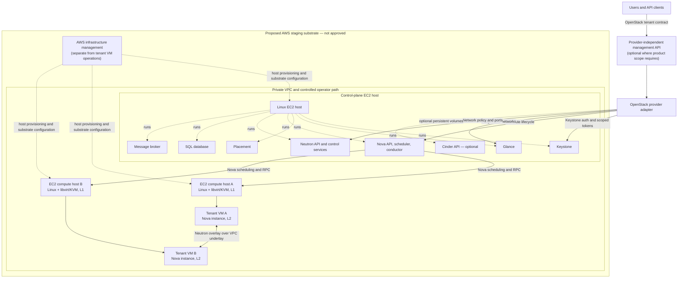

# Option A technical reference design — deferred historical evaluation

**Status:** Superseded for current project scope by the final decision to continue the original local OpenStack POC and select staging independently. This document is retained as a historical architectural evaluation only. AWS-hosted OpenStack and AWS-native tenant provisioning are not active implementation or staging requirements and are not approved for deployment.

The active relationship between local POC, staging, and data-center production is defined in [`../staging-release-plan.md`](../staging-release-plan.md). No AWS account, endpoint, resource, or feasibility claim is implied by this preserved evaluation.

The design sections below preserve the assumptions and analysis from the earlier Option A review. Where they describe AWS-hosted staging, treat those statements as historical evaluation content; the current scope and release sequence are in the staging plan linked above.

**Scope:** AWS-hosted OpenStack for staging; Nova-managed tenant VMs; Neutron tenant networking; intended production transition to OpenStack on organization-owned physical data-center infrastructure.

**Historical decision boundary:** At the time this evaluation was prepared, Nova had been selected as the tenant compute path and this document was approved as a planning reference. The later project-scope decision supersedes its AWS-hosted staging proposal. Nova remains selected and Proxmox deprecated; this document does not approve an AWS environment, select an AWS instance type or Region, select a Neutron mechanism driver, choose a storage backend, or claim that any OpenStack service is installed or operational.

## 1. Design goals

1. Keep the tenant compute contract OpenStack-based: the application management/API layer requests and observes tenant VM operations through Nova and related OpenStack APIs.
2. Use AWS only as the proposed temporary infrastructure substrate for staging. AWS EC2 instance IDs, IAM, VPC, EBS, and other AWS-specific configuration belong to the infrastructure-hosting and deployment boundary.
3. Run Nova compute on a Linux host using libvirt/KVM if a selected EC2 type exposes the required virtualization support and the full Nova path is validated.
4. Use Neutron for tenant networks and policy. Do not treat AWS security groups as tenant VM security groups.
5. Reuse application behavior, OpenStack-facing contracts, and deployment knowledge in production where compatible. Reconfigure the hardware, physical network, storage, endpoint, and environment-specific settings for the data center.
6. Keep this design falsifiable: each proposed capability has a validation gate and evidence requirement.

## 2. Reference topology

The proposed minimum for a useful cross-host networking validation is one control-plane host and two Nova compute hosts. Each is an AWS EC2 virtual instance. The compute hosts are L1 hypervisors; Nova tenant VMs are L2 guests.



The diagram is logical. It does not establish support for the topology, imply deployment, or specify a final deployment tool. The optional Cinder path is excluded from the first slice unless persistent tenant storage is approved.

### Topology variants and what they prove

| Variant | Shape | Evidence it can provide | Limits |
|---|---|---|---|
| Lifecycle smoke | One control-plane host, one nested-KVM compute host, one test tenant project and VM | Authentication, image selection, Nova create/inspect/delete, basic Neutron port/network attachment | No cross-compute overlay path, no compute host failover, no HA or capacity claim |
| Minimum architecture validation | One control-plane host and two nested-KVM compute hosts, with tenant VMs placed on different hosts | Adds cross-host overlay reachability, tenant isolation, scheduler placement across hosts, and cleanup across multiple hosts | Still a small single-environment validation; no production HA, physical data-center, scale, or equivalent performance evidence |
| Production-like staging | Multiple control-plane and compute failure domains sized from approved workloads and SLOs | Can exercise the approved resilience, capacity, upgrade, backup, and operations targets | Requires workload, sizing, ownership, cost, and availability decisions not yet recorded |

The two-compute-host shape is the recommended minimum if the staging release is expected to validate Neutron overlays. If cost or quota limits require one compute host, restrict the acceptance claim to same-host behavior and keep cross-host networking open.

## 3. OpenStack service topology and dependencies

The OpenStack installation guide lists Keystone, Glance, Placement, Nova, and Neutron as its minimum service deployment. Nova documentation identifies Keystone, Glance, Neutron, and Placement as requirements for a functioning Nova deployment. Nova also uses a SQL database for control-plane state and a message queue for service communication. A standard small topology may co-locate supporting services on the controller for an initial validation, subject to the selected deployment method.

| Service/component | Reference role | Initial scope |
|---|---|---|
| Keystone | Authentication, projects, roles, and scoped service/user access | Required |
| Glance | VM image catalog and image access | Required for image-backed VM launch |
| Placement | Compute inventory and allocation used by scheduling | Required |
| Nova API, scheduler, conductor, compute | Tenant instance API, placement decision, coordination, and hypervisor lifecycle | Required; `nova-compute` runs on the EC2 L1 compute hosts |
| Neutron API and selected network back end | Tenant networks, subnets, ports, security groups, DHCP/metadata and routing functions as selected | Required |
| SQL database | Durable OpenStack service state | Required by selected core services; service databases remain owned by those services |
| Message broker | RPC/work distribution between Nova and other services that use it | Required by the selected Nova deployment; do not reuse it as an application job queue by default |
| Memcached or release-specific token cache | Keystone token caching in common deployment patterns | Confirm against selected release/deployment method |
| Cinder | Persistent tenant block volumes, snapshots, and volume lifecycle | Optional; include only with a selected and validated backend |
| Horizon | Browser dashboard | Optional; not required for the API lifecycle slice |
| Telemetry, billing, orchestration, object storage, load balancing | Separate service capabilities | Out of the minimum scope unless an approved workflow requires them |

The OpenStack control-plane database and broker are separate from any application-owned database or asynchronous job system. Do not add PostgreSQL, Redis, Celery, or another application queue solely because OpenStack uses databases and messaging. First define whether the management API needs durable application-owned job records, and then choose its state/worker design from that requirement.

## 4. Compute and nested virtualization design

### Proposed execution path

1. AWS Nitro hosts an EC2 VM with nested virtualization enabled (L1).
2. The L1 Linux system exposes CPU virtualization extensions and `/dev/kvm` to the libvirt/KVM stack.
3. Nova `nova-compute` communicates with libvirt and creates tenant VMs (L2).
4. Nova and Placement report the L1 host's allocatable capacity and schedule L2 instances subject to the selected flavor, quotas, scheduler policy, and conservative overcommit settings.

AWS currently documents KVM as a supported L1 hypervisor for nested virtualization on selected EC2 instance types. AWS also recommends evaluating bare metal for workloads with strict latency or performance sensitivity. These statements support feasibility in principle; they do not validate Nova, a selected image/kernel, libvirt, instance size, or workload performance in this project. See [AWS nested virtualization](https://docs.aws.amazon.com/AWSEC2/latest/UserGuide/amazon-ec2-nested-virtualization.html) and [Nova compute overview](https://docs.openstack.org/nova/latest/install/get-started-compute.html).

### Public documentation discrepancy and candidate boundary

AWS's [nested virtualization user guide](https://docs.aws.amazon.com/AWSEC2/latest/UserGuide/amazon-ec2-nested-virtualization.html) lists 7th- and 8th-generation families. AWS's June 18, 2026 [What's New announcement](https://aws.amazon.com/about-aws/whats-new/2026/06/nested-virtualization-intel-us-gov-cloud/) explicitly extends support to additional 7th- and 8th-generation Intel families and U.S. GovCloud Regions. The [EC2 launch-template CPU options reference](https://docs.aws.amazon.com/AWSEC2/latest/APIReference/API_LaunchTemplateCpuOptionsRequest.html), however, still says support is limited to 8th-generation Intel families `c8i`, `m8i`, `r8i`, and their flex variants. The launch-template reference appears stale or incomplete relative to AWS's current announcement; this is an inference from the conflicting AWS sources.

For planning, use the current user guide and announcement as family-level evidence that support extends beyond 8th-generation Intel. The sources still differ on some entries: for example, the user guide lists `R7iz` and `I7ie` while the announcement does not, and the announcement lists `C7id` while the guide does not. This is not an exact instance-type, Region, quota, capacity, or performance claim, and no type is selected here. Before deployment approval, verify exact-type feature support and regional offerings through an approved read-only process, reconcile the API-reference discrepancy for the intended launch path, and check quota and capacity.

### Capacity and failure boundaries

- Size from the intended tenant workload: total vCPU, RAM, image and ephemeral-disk footprint, expected concurrency, and network/storage demand. No workload profile or SLO is yet available to derive instance sizes or overcommit ratios.
- The EC2 instance is the billed and outer failure unit. Nova flavors describe inner guest resources; they must not promise capacity beyond measured and policy-reserved L1 capacity.
- Reserve explicit L1 CPU and memory for the operating system, OpenStack compute services, Neutron agents, and monitoring. Do not assign every outer vCPU or GiB to tenants.
- A one-compute-host staging design has no compute-host redundancy. Two compute hosts allow a limited host-loss exercise but do not establish production failover capacity.
- Treat nested guest performance, CPU feature exposure, oversubscription behavior, host maintenance, suspend/resume, and live migration as unverified until tested on the approved design. Do not use staging results as physical data-center benchmarks.

## 5. Neutron networking design

### Initial network intent

Use private tenant self-service networks and Neutron security groups. Use an overlay between compute hosts for tenant networks if the selected Neutron mechanism supports it and AWS underlay reachability is demonstrated. Keep management and OpenStack API endpoints private. Exclude direct tenant provider-L2/VLAN attachment and public tenant ingress from the initial scope.

The Neutron mechanism driver and tunnel protocol remain owner decisions. OVN or ML2/OVS with an overlay are candidates to evaluate, not selections made here. The chosen design must specify the controller/network agents, DHCP/metadata behavior, router placement, control-plane path, and failure behavior.

### Cross-host packet path to validate

For an east-west packet between two tenant VMs on different EC2 compute hosts:

1. Guest A emits a packet on its Neutron port.
2. The local virtual switch applies the selected Neutron security-group policy and encapsulates the tenant packet using the selected overlay.
3. The outer packet travels from compute host A's AWS-assigned underlay address to compute host B's AWS-assigned underlay address through the VPC.
4. AWS routing controls and the outer EC2 security group must allow that protocol and destination between the intended compute hosts.
5. Host B decapsulates the packet, applies the receiving virtual port policy, and delivers it to guest B.

The exact protocol, UDP port, routes, host security-group rules, and MTU must be specified by the selected mechanism and release. AWS states that packets using MAC/IP addresses not assigned to the EC2 network interface are dropped; this constrains transparent L2/provider networking and makes the host-to-host overlay boundary important. See [EC2 network infrastructure security](https://docs.aws.amazon.com/AWSEC2/latest/UserGuide/infrastructure-security.html).

AWS security groups protect attached AWS resources and are stateful. They filter the outer EC2 network path; they are not evidence that Neutron enforces tenant VM policy. Test Neutron isolation with separate projects, forbidden and allowed flows, ingress/egress, and attempted cross-tenant traffic. Keep AWS security-group rules narrow and scoped to the host roles and private CIDRs. See [VPC security groups](https://docs.aws.amazon.com/vpc/latest/userguide/vpc-security-groups.html).

### North-south and external access

The initial staging scope should avoid public tenant ingress. First prove private tenant-to-tenant behavior and a controlled management path. If tenant egress or external ingress becomes a requirement, select and document the Neutron router/NAT/floating-IP design, AWS route path, source/destination-check behavior, address ownership, DNS, and exposure rules. AWS documents that source/destination checks can be disabled for EC2 interfaces used for routing, NAT, or firewall functions; whether that applies depends on the selected topology. Do not assume Neutron floating IPs map directly to public AWS addresses.

### MTU

Derive guest MTU from the smallest underlay path MTU after encapsulation overhead. Neutron documentation describes subtracting overlay overhead from the underlay MTU and notes that underlay network devices also need matching MTU configuration. The AWS VPC path, EC2 network mode, overlay protocol, and guest behavior must be checked together; do not hard-code a value from a different environment. See [Neutron MTU considerations](https://docs.openstack.org/neutron/latest/admin/config-mtu.html).

## 6. Images and storage

### First validation slice

- Use Glance to catalog a small approved test image.
- Use Nova ephemeral instance storage for disposable lifecycle tests.
- Place OpenStack host operating systems, control-plane state, Glance data, and Nova compute data on explicitly inventoried host storage.
- On AWS, EBS may provide block devices to the EC2 hosts. This is infrastructure-host storage; it is not automatically a Cinder tenant volume service.
- Record retention and deletion behavior for images, host disks, test guests, and snapshots. Keep test data non-sensitive.

AWS states that EBS performance depends on both volume and instance configuration and workload. The staged EBS-backed environment therefore cannot stand in for production storage performance. See [EBS volume performance](https://docs.aws.amazon.com/ebs/latest/userguide/ebs-performance.html).

### Persistent tenant storage decision

Cinder is optional in the minimum OpenStack service deployment. If persistent tenant volumes are an acceptance requirement, add Cinder and choose a supported backend, attachment protocol, failure/recovery behavior, backup path, and quota policy. For staging, the backend must be clearly identified as AWS-specific or portable; do not assume an EC2 host's EBS device is a production-compatible Cinder backend. For production, select the data-center storage system and supported Cinder driver independently. See [Cinder service overview](https://docs.openstack.org/cinder/latest/configuration/block-storage/block-storage-overview.html).

Image bytes can be moved only after checking image format, architecture, firmware/boot mode, guest drivers, and licensing constraints. Database state, tenant volumes, network topology, and secrets require separate migration plans; this design does not promise an in-place AWS-to-data-center migration.

## 7. Capacity, cost, quotas, and cleanup

Do not estimate cost until the Region, exact host types/count, runtime, storage, traffic shape, retention, and optional services are known. Build the estimate from these categories:

- EC2 host instance-hours for control-plane and nested compute hosts. AWS documents no separate nested-virtualization charge; the EC2 instances remain billable.
- EBS capacity and any selected provisioned performance, plus snapshots and retained backups.
- VPC data transfer, NAT gateway hours and data processing if selected, public IPv4 addresses, load balancers, and any inter-availability-zone traffic.
- Logs, metrics, alarms, support, and any separate security or backup services.

Use the selected Region's current pricing sources and the approved usage assumptions; this document contains no price estimate. AWS lists EC2 usage and related services separately in its [EC2 pricing](https://aws.amazon.com/ec2/pricing/on-demand/) and [VPC pricing](https://aws.amazon.com/vpc/pricing/) material.

Check account and Region quota/capacity for EC2 vCPUs and candidate families, EBS volumes and performance, network interfaces, private/public addresses, VPC resources, security groups, and rules. Check OpenStack project quotas separately for instances, cores, RAM, ports, networks, security groups, and Cinder volumes if enabled. Exact quota values and available capacity are environment-specific and have not been inspected.

Before any resource approval, assign an owner, expiry, cost center/tagging plan, alert/stop threshold, and cleanup runbook. The runbook must account for tenant instances, images, volumes, snapshots, EC2 hosts, EBS volumes, addresses, NAT/load-balancer resources, logs, and network resources. Record cleanup completion; stopping an EC2 host alone may leave separately billed storage or network resources.

## 8. Management/API and provider boundary

```text
Tenant API/client
    -> provider-independent management API (only if required by product scope)
        -> OpenStack adapter
            -> Keystone for identity and scoped authorization
            -> Nova for tenant VM lifecycle
            -> Glance for images
            -> Neutron for tenant network resources
            -> Cinder only if persistent volumes are approved

Separate infrastructure/deployment boundary:
    AWS-specific staging host provisioning and networking
    data-center host, fabric, and storage deployment configuration
```

Boundary rules:

- Tenant-facing API models and resource semantics should use stable platform concepts and OpenStack contract identifiers. Keep AWS EC2 host IDs and AWS infrastructure objects out of tenant VM resource contracts.
- Keep provider-specific implementation behind a provider adapter. The adapter owns OpenStack endpoint/version configuration and translates manager operations to OpenStack APIs; it does not create AWS EC2 tenant instances.
- Keep AWS credentials, IAM permissions, VPC configuration, EC2 host provisioning, and AWS cost tags in the infrastructure management/deployment layer. Do not let the tenant VM lifecycle path call EC2 APIs to create tenant VMs.
- Keep OpenStack cloud endpoints, service credentials, and environment-specific IDs in protected runtime configuration, not source code or tenant responses.
- Preserve capability distinctions such as available, simulated, and unavailable. Fixture success is not provider evidence.
- Do not add an application queue or database by default. If management workflows require durable asynchronous jobs, define job persistence, retries, idempotency, reconciliation, and ownership separately from Nova's internal message queue.

This boundary supports reuse of application logic while allowing different infrastructure automation for AWS staging and data-center production. It does not guarantee zero environment-specific configuration.

## 9. AWS-to-data-center transition

| Area | Reuse in principle | Reconfigure or replace for production |
|---|---|---|
| Management application | API logic, provider-neutral catalog and lifecycle abstractions, authorization checks, job semantics, tests | Endpoint URLs, trust roots, secret references, supported OpenStack API versions and policy configuration |
| Tenant VM management | Nova API integration and lifecycle workflows, if compatible with the production OpenStack release | Nova compute hosts, CPU inventory/traits, flavors, scheduler aggregates, host maintenance and capacity policy |
| Neutron | Tenant network contracts and policy tests | Physical network mappings, tunnels, MTU, routing, VLAN/provider networks, external gateways, IPAM and firewall integration |
| Images | Image artifacts where architecture and boot metadata are compatible | Image store, transfer/replication, supported formats, trusted-image process and access policy |
| Storage | Storage API contracts and application workflows | EBS host volumes removed; production ephemeral storage and Cinder backend/driver selected for data-center storage |
| Infrastructure operations | Runbooks and environment-neutral deployment logic where supported | Replace EC2, VPC, IAM, EBS, AWS monitoring and AWS-specific automation with data-center equivalents |
| Validation | API contract, tenant policy and basic OpenStack service behavior | Re-run hardware, network, storage, failure-domain, performance, recovery and operations acceptance on production-like physical infrastructure |

AWS staging can validate software and OpenStack behavior exercised within its topology. It cannot establish physical server compatibility, data-center fabric behavior, storage performance, facility resilience, production capacity, or performance parity. Production release therefore requires independent evidence for those domains.

## 10. Security and operations baseline

- Private-by-default control plane; no public OpenStack endpoints in the initial scope.
- Keystone project scope and roles for users and services; separate operator access from tenant access.
- Least-privilege AWS permissions for infrastructure operators and deployment automation. Keep AWS infrastructure credentials separate from OpenStack service credentials.
- TLS and certificate trust for management-to-OpenStack API paths according to the approved deployment.
- Narrow EC2 security-group and host-firewall rules; document every required control-plane and overlay flow.
- Patch and harden the L1 host, hypervisor, L2 guests, and OpenStack services. AWS states customers remain responsible for securing the nested hypervisor and guest layers.
- Record API audit events, OpenStack service health, failed instance operations, orphaned resources, host capacity, disk usage, and cleanup actions with named owners.
- Define backups and restore only for state selected for persistence. Do not back up or expose credentials in repository files.
- Enforce project quotas for instances, cores, RAM, networks, ports, security groups, and volumes if Cinder is enabled. Check AWS account/Region service quotas separately; do not assume default quotas are adequate.
- Define resource tags, owner, expiry, cleanup runbook, and cost alert/stop conditions before any approved resource creation.

## 11. Feasibility gates and evidence

| Gate | Required evidence to pass | Current status |
|---|---|---|
| G0 — Scope and ownership | Workload, user/project model, data classification, operators, security approver, budget owner, acceptance owner, retention and cleanup owner | Open |
| G1 — AWS host feasibility | Reconciled nested-virtualization documentation; exact candidate type and Region; support, capacity and quotas; Linux/KVM/libvirt prerequisites; resource/cost model | Open; public AWS documentation lists candidate families but contains a scope discrepancy |
| G1 — Network feasibility | Selected Neutron mechanism and overlay; approved IP plan; required flows; AWS route/security-group design; MTU calculation; private north-south scope; tenant isolation test plan | Open |
| G1 — Storage feasibility | Glance storage location, Nova ephemeral storage lifecycle, EBS host-storage sizing assumptions; decision whether Cinder/persistent tenant storage is required | Open |
| G1 — Portability | AWS-specific infrastructure boundary; data-center deployment/configuration mapping; list of staging-only behavior and production revalidation | Open |
| G2 — Approved foundation | Explicit environment/resource approval, reviewed deployment plan, access control, secrets handling, rollback and cleanup plan | Not authorized by this design |
| G3 — Functional validation | Evidence of Keystone scope, image access, Nova lifecycle, cross-host Neutron reachability/isolation, quota behavior, failure handling, audit logs and cleanup | Not run; no deployment evidence is present in the reviewed repository |
| Production readiness | Physical host, underlay, storage, capacity, security, operational, recovery and performance evidence on the intended data-center environment | Open; AWS staging cannot close this gate |

No gate is passed by this design document. A planning result does not establish deployment, feasibility, or release acceptance.

## 12. Decisions required before implementation or resource approval

1. **OpenStack release and deployment method:** supported release, distribution, deployment tooling, operator, and upgrade lifecycle.
2. **AWS staging boundary:** account, Region, VPC ownership, permitted availability zones, candidate EC2 family/size, compute count, duration, quota, budget, and access method.
3. **Neutron model:** OVN or ML2/OVS (or another supported option), tunnel protocol, DHCP/metadata/router placement, tenant CIDRs, allowed east-west traffic, and whether any north-south traffic is needed.
4. **External connectivity:** private-only, controlled outbound access, or a defined ingress/floating-IP model. The initial reference scope assumes no public tenant ingress.
5. **Storage:** ephemeral-only initial scope or Cinder volumes; if Cinder is required, staging and production backends and migration/backup requirements.
6. **Capacity and resilience:** tenant workload profile, flavor policy, CPU/RAM overcommit limits, host-failure reserve, single-AZ versus multi-AZ validation, and acceptance SLOs.
7. **Identity and security:** Keystone project/role design, operator access, service identities, secrets system, audit retention, and security review owner.
8. **Management API scope:** whether a custom management API is required, and if asynchronous jobs need application-owned durable state beyond Nova's service workflow.
9. **Production mapping:** data-center host, network fabric, storage, IPAM, external access, and operations owners that must be represented in staging design.
10. **Cost and lifecycle controls:** cost ceiling, estimate assumptions, resource expiry, cleanup owner, log/data retention, and stop/rollback authority.

## 13. Historical next planning task — superseded

At the time of this evaluation, the proposed follow-up was review of the [Option A Gate 1 package](option-a-gate1-feasibility-package.md). That sequence is superseded; the package is retained for traceability and is not an active implementation task or requirement.

## 14. Repository evidence and status

This document records an earlier Option A proposal and is not the current implementation plan. The current project scope continues the local POC, selects staging independently, and retains the data-center production direction. Nova remains the chosen tenant compute path; real Nova operation remains unverified. See [`requirements-specification.md`](../requirements/requirements-specification.md), [`staging-release-plan.md`](../staging-release-plan.md), [`openstack-service-mapping.md`](openstack-service-mapping.md), [`architecture-gaps.md`](architecture-gaps.md), [`environment-audit.md`](environment-audit.md), and [`hardware-feasibility.md`](hardware-feasibility.md).

## Public technical references

- [AWS: Use nested virtualization to run hypervisors in Amazon EC2 instances](https://docs.aws.amazon.com/AWSEC2/latest/UserGuide/amazon-ec2-nested-virtualization.html)
- [AWS What's New: Expanded nested virtualization support, June 18, 2026](https://aws.amazon.com/about-aws/whats-new/2026/06/nested-virtualization-intel-us-gov-cloud/)
- [AWS EC2 API: LaunchTemplateCpuOptionsRequest](https://docs.aws.amazon.com/AWSEC2/latest/APIReference/API_LaunchTemplateCpuOptionsRequest.html)
- [AWS: Infrastructure security in Amazon EC2](https://docs.aws.amazon.com/AWSEC2/latest/UserGuide/infrastructure-security.html)
- [AWS: Control traffic using security groups](https://docs.aws.amazon.com/vpc/latest/userguide/vpc-security-groups.html)
- [OpenStack: Install OpenStack services](https://docs.openstack.org/install-guide/openstack-services.html)
- [Nova: Compute service overview](https://docs.openstack.org/nova/latest/install/get-started-compute.html)
- [Neutron: MTU considerations](https://docs.openstack.org/neutron/latest/admin/config-mtu.html)
- [Cinder: Block Storage service overview](https://docs.openstack.org/cinder/latest/configuration/block-storage/block-storage-overview.html)
- [AWS: Amazon EBS volume performance](https://docs.aws.amazon.com/ebs/latest/userguide/ebs-performance.html)
- [AWS: EC2 On-Demand pricing](https://aws.amazon.com/ec2/pricing/on-demand/)
- [AWS: VPC pricing](https://aws.amazon.com/vpc/pricing/)
