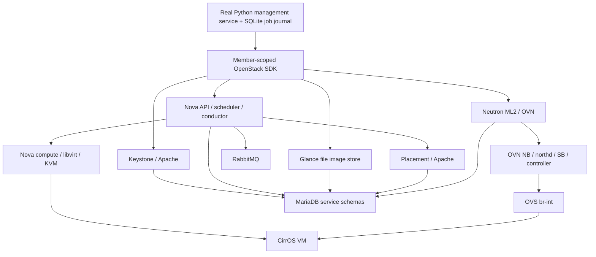

# Task 11 — deployed architecture and operational closeout

The approved continuation is tracked in [recovery and restart acceptance](task11-recovery-and-restart.md): isolated protected-backup restore/recovered guest boot, restart readiness, controlled service cycle and WSL distribution restart passed. Restore report: `/root/openstack-poc-acceptance/restore-rehearsal-5zlr6r17/report.json`; readiness report: `/root/openstack-poc-acceptance/restart-readiness-7103dd5dc08d424bb7d1b0ae03d27f4b.json`; cycle: `/root/openstack-poc-acceptance/service-cycle.json`; verified WSL restart: `/root/openstack-poc-acceptance/wsl-restart.json`. Root WSL review `/root/openstack-poc-acceptance/wsl-restart-review-6fdb77f29a084b6ea7d0252fc0fffcb9.json` independently validated saved cycle evidence and fresh cloud/guest readiness. Codex also validated the final protected restart evidence and pinned backup hashes. The retained demo and seven workers recovered; local POC acceptance is complete. Repository publication is tracked separately.

Current status: real core-cloud/application acceptance, temporary cleanup, guest CPU checks, API/hook hardening, successful logrotate timer invocation, RabbitMQ/EPMD loopback hardening, and Apache legacy-route restriction passed. The operator's verified Apache recovery point is `/root/openstack-poc-acceptance/apache-legacy-route-recovery-ui5ys952`; protected result: `/root/openstack-poc-acceptance/apache-legacy-route-hardening.json`. `/volume` and `/image` now deny the host `eth0` source with HTTP 403 while preserving loopback access. `/`, `/identity`, `/placement`, the authenticated OpenStack APIs and the retained guest passed unchanged/recovery checks. At least one legacy upstream still returns HTTP 503 locally; this remains documented as a backend limitation. Earlier dated sections retain their original observations. This is a local POC, not staging or production acceptance. The [chronological host evidence](task11-live-deployment-evidence.md) and [application evidence](task11-application-integration.md) distinguish real results from offline tests.

## Actual architecture and release boundary

The existing Windows 11 laptop runs its existing Ubuntu 22.04 WSL2 distribution. Ubuntu Cloud Archive `jammy-updates/caracal` packages provide one controller/compute node; configuration was performed by the approved local scripts and operator commands. There is no DevStack checkout/deployment. The [supplied architecture image](architecture-diagram.png.jpeg) was reviewed together with the requirements: its H100, Proxmox-first, Kubernetes, payment and offsite-storage components do not describe this implementation. Nova is the selected compute path. No new distribution, computer, cloud provider or remote Git push was used.



The application service is an in-process Python library with a bounded worker and durable SQLite journal, not a deployed custom HTTP gateway or web portal. Keystone and Placement run under Apache mod_wsgi, so missing standalone `keystone.service`/`placement-api.service` units are expected. The fixture path remains simulated and separate.

Previously observed package versions are Nova 29.2.0, Neutron 24.1.0, Keystone 25.0.0, Glance 28.1.0, Placement 11.0.0, MariaDB 10.6.23, RabbitMQ 3.9.27, OVS 3.3.9 and OVN 24.03.6. The operational review records full currently installed package strings for these services, libvirt/QEMU, Apache and the SDK; it does not infer versions from the intended release.

OpenStack documents [Caracal packages for Ubuntu 22.04](https://docs.openstack.org/install-guide/environment-packages-ubuntu.html). The [upstream release index](https://releases.openstack.org/) currently labels Caracal **Unmaintained**. Canonical's [package lifecycle table](https://canonical.com/openstack/docs/latest/reference/release-cycle-and-supported-versions/#openstack-packages) lists UCA 2024.1 standard EOL as April 2027 and distinguishes package maintenance from full support for third-party deployments. This manual WSL POC is not a vendor-validated deployment. Package availability does not certify WSL support or provide a production upgrade guarantee. Ubuntu remains 22.04; future upgrades need their own asset/backup/package review.

| Service | Configured catalog URL | Implementation |
| --- | --- | --- |
| Keystone | `http://127.0.0.1:5000/v3/` | Apache mod_wsgi / MariaDB |
| Glance | `http://127.0.0.1:9292` | Glance API / protected file store / MariaDB |
| Placement | `http://127.0.0.1:8778` | Apache mod_wsgi / MariaDB |
| Nova | `http://127.0.0.1:8774/v2.1` | API/conductor/scheduler/compute, cells v2, RabbitMQ, Placement, KVM/libvirt |
| Neutron | `http://127.0.0.1:9696` | ML2/OVN, port security and OVN metadata agent |

Catalog loopback URLs do not prove loopback listener bindings. OVN NB/SB TCP listeners were explicitly verified on `127.0.0.1:6641/6642`. Nova/Neutron were configured to loopback. Apache, Glance and RabbitMQ initially had wildcard listeners; API hardening corrected the core API bindings and alias access. The pre-hardening inspection also found RabbitMQ 5672 and Erlang distribution 25672 wildcard-bound, and EPMD on `[::]:4369`; the later backed-up RabbitMQ/EPMD correction and recovery check passed (see below). Shared Apache port 80 remains a separate listener-review item. These HTTP URLs use no TLS and are appropriate only within the deliberately restricted local access boundary. No claim of internet isolation follows from WSL NAT alone.

## Verified acceptance and preserved demo

| Journey | Actual evidence | Boundary |
| --- | --- | --- |
| Identity/projects/roles | Admin and service authentication; two member projects' own-resource access and denied/hidden foreign access | Temporary members/projects now removed; not a full Keystone policy audit |
| Image and catalog | Pinned-source CirrOS upload, active private images; tenant image secure hashes and downloaded SHA256; actual API catalog | Cinder/storage entries remain unavailable; no invented capacity |
| Compute | Real Nova create/inspect, actual KVM/QMP; direct stop/start/soft reboot with changed guest boot ID and recovered guest | One WSL compute host; no HA, live migration or GPU passthrough proof |
| Networking | DHCP/IP/MAC/MTU, pinned-key SSH, instance metadata, MTU-sized DF ping; three fresh denied TCP/22 connections with ICMP control and rule restoration | Metadata-namespace access, MTU 1442; no external router/floating IP or internet test |
| Project boundaries | Member-scoped API denial/filtering and other-project token rejection; two networks' positive ARP controls and no cross-network ARP replies | Bounded ARP path, not all protocols/multi-host/hostile tenants |
| Real application | Create/inspect and stop/start/delete through real SDK jobs with observed provider completion, durable duplicate lookup and independent host cleanup | In-process application service; uncertain operations require reconciliation |
| VM deletion | Operator Nova/Neutron absence, no libvirt domain/source disk, empty Placement allocations and zero temporary tenant compute usage | A retained recovery copy is not a leaked live VM allocation |
| Dependencies | All original temporary dependencies/users/projects absent; supplemental default group absent; selected OVN switches/namespaces removed | Original demo assets and historical infrastructure retained |
| CPU workload | Retained guest returned `5000050000` for sum 1..100000 over pinned-key SSH | CPU smoke workload; not AI inference or a performance benchmark |

Original demo VM `82382430-4b64-4386-a55b-8468e04da011` remains `ACTIVE` after cleanup, on private network `6ee5ad82-efc5-405d-bf5c-a4953e9a063b`, subnet `172.30.240.0/24`, guest `172.30.240.154`, metadata source `172.30.240.2`. Its base image is `da953e4e-38ca-47d2-b97a-b62d3f33646a`. Its remaining flavor/key/group/port IDs are retained in root-only `run.json`. The local probe rules permit only TCP/22 and ICMP from the metadata address `/32`. The app VM and both temporary project networks are deleted; old application acceptance commands must not be replayed.

Temporary cleanup completed with supplemental recovery bundle `/root/openstack-poc-acceptance/dependency-recovery-b0a2694420364856a755347a048ea36a-eiocsu57`. The operator verified the reviewed recreated default-group removal, both empty task network inventories, both user/project removals and final OVN/namespace absence. This result supersedes the earlier partial-cleanup entries; the history is preserved for incident traceability.

## Current operations review command

The operator completed this command successfully. It is retained for later health verification; the next action is the scoped correction below.

```bash
sudo /usr/bin/python3 -B /home/sneha/projects/openstack-cloud-poc/scripts/local-openstack/review_operations.py
```

The [review script](../../scripts/local-openstack/review_operations.py) observes named systemd units, exact package versions, selected TCP/UDP listener bindings, Linux memory/disk and mounted Windows C: capacity when available. It authenticates through the existing protected operator credentials, checks the retained image/VM/network/port/flavor, current Nova/OVN health and matching Placement inventory, and returns credential-free catalog endpoints. It checks logrotate configuration hashes, bounded-call flags and parser debug mode; it does not execute postrotate hooks, rotate logs, reset failed units or enable the timer.

The script runs one bounded guest `awk` arithmetic command over the existing private key and existing pinned SSH trust with `StrictHostKeyChecking=yes`. It requires the exact result `5000050000` for the sum of 1 through 100000. It changes no VM, network, service, guest file or trust entry. The only intended persistent write is a new 0600 report under the existing 0700 root acceptance directory, named `operations-review-<unique UUID>.json`; old reports/manifests/backups are retained. No tokens, passwords, environment values or configuration contents are printed. Failed observations report only their error class, and collection completion does not imply operational acceptance.

Systemd observation `PASS` means the properties were read; required active units also have an explicit `expected_profile_match` flag. Inactive `logrotate.timer`, idle `logrotate.service` and intentionally inactive VTEP are reported without inventing a service failure. Listener `loopback=false` identifies a binding that needs review; it does not establish Windows/LAN/internet reachability. SSH/workload success is separate from systemd state.

At the earlier listener review, changes and timer reactivation were held pending bounded hook validation. Local configuration inspection found OVN `ovs-appctl --timeout=5` but unbounded calls in the OVS logrotate hook. The operator later verified both bounded control probes and actual postrotate sections, set the whole-job timeout, then observed a successful timer invocation; the timer is now active and must not be reactivated as part of this closeout. Changes to shared Apache or historical uWSGI routes must preserve unrelated applications.

## Verified operations review and remaining findings

The operator saved `/root/openstack-poc-acceptance/operations-review-68f79bba5a35404ab2573968235db55a.json`. Every required core unit was loaded/active with its expected profile. Nova compute, both required OVN agents and matching Placement inventory were healthy. Authenticated catalog/resource reads passed; the retained original VM was `ACTIVE`, with 1 vCPU/256 MiB/1 GiB flavor `7f0e32eb-7fd1-4047-8954-1dde8078d459`, port `74677cfa-f5cb-4adc-8e6e-5c0ca26e2136` and MTU 1442. The actual guest arithmetic result passed over pinned-key SSH. These are live operator-supplied observations, distinct from the local shell test.

| Installed component | Full observed package version |
| --- | --- |
| Keystone | `2:25.0.0-0ubuntu1.4~cloud0` |
| Glance API | `2:28.1.0-0ubuntu1~cloud0` |
| Placement API | `1:11.0.0-0ubuntu1~cloud0` |
| Nova API/compute | `3:29.2.0-0ubuntu1.8~cloud0` |
| Neutron API/OVN metadata | `2:24.1.0-0ubuntu1.2~cloud0` |
| Open vSwitch | `3.3.9-0ubuntu0.24.04.1~cloud0` |
| OVN central/host | `24.03.6-0ubuntu0.24.04.1~cloud0` |
| libvirt daemon | `8.0.0-1ubuntu7.21` |
| QEMU x86 | `1:6.2+dfsg-2ubuntu6.31` |
| MariaDB | `1:10.6.23-0ubuntu0.22.04.1` |
| RabbitMQ | `3.9.27-0ubuntu0.6` |
| Apache | `2.4.52-1ubuntu4.25` |
| mod_wsgi | `4.9.0-1ubuntu0.1` |
| Memcached | `1.6.14-1ubuntu0.3` |
| OpenStackClient | `6.6.0-0ubuntu2~cloud0` |
| OpenStack SDK | `3.0.0-0ubuntu2~cloud0` |

Linux root free space was 1,001,853,288,448 bytes; Windows C: mount free space was 806,689,443,840 bytes. Linux virtual filesystem capacity is not physical Windows capacity. `MemAvailable` was 1,585,056 KiB (about 1.51 GiB), with 820,020 KiB swap used. These are point observations, not sustained performance guarantees. Limiting the restarted APIs to one worker each is a modest laptop capacity correction; no exact memory improvement is claimed before measurement.

TCP ports 8774/8775/9696, 6640/6641/6642, 11211 and 3306 were loopback-only. Ports 5000/8778, 9292, 5672, 4369, 25672 and shared Apache port 80 had wildcard bindings. This is listener evidence, not a LAN/internet reachability test. Logrotate debug parsing passed, OVN calls were bounded, and OVS calls were not. Both logrotate job and timer were inactive; the job's `TimeoutStartUSec` was `infinity`. The timer and VTEP were still enabled, so a future host boot can activate them; restart behavior has not been tested.

## Prepared API and logrotate correction

```bash
sudo /usr/bin/python3 -B /home/sneha/projects/openstack-cloud-poc/scripts/local-openstack/harden_local_apis.py --apply
```

The [scoped script](../../scripts/local-openstack/harden_local_apis.py) changes exactly five targets after verified recovery snapshots:

- `/etc/apache2/sites-available/keystone.conf`: port/vhost 5000 to `127.0.0.1`, one WSGI process, explicit loopback client authorization on global `/identity` alias.
- `/etc/apache2/sites-available/placement-api.conf`: the same treatment for 8778 and `/placement`.
- `/etc/glance/glance-api.conf`: `[DEFAULT] bind_host=127.0.0.1` and `workers=1`; existing database/authentication/unrelated settings retained.
- `/etc/logrotate.d/openvswitch-switch`: add only `--timeout=5` to its existing `ovs-appctl` call, retaining rotation policy and script structure.
- New `/etc/systemd/system/logrotate.service.d/50-openstack-poc-timeout.conf`: `TimeoutStartSec=5min`, `TimeoutStopSec=15s` for future jobs. The vendor unit is preserved.

The Apache address/port behavior follows [Apache 2.4 binding documentation](https://httpd.apache.org/docs/2.4/bind.html); a full restart is used for the Listen change. Global alias access uses [explicit loopback IP authorization](https://httpd.apache.org/docs/2.4/mod/mod_authz_host.html). Apache and Glance restart, briefly interrupting their API traffic and shared Apache routes. Legacy Apache configuration files and port-80 listener remain intact. No RabbitMQ/EPMD, libvirt, OVS/OVN daemon, VM, network, package, host DNS or firewall change occurs in this stage. The master deployment authorization covers this scoped correction; normal sudo authentication is still required.

Preparation creates a new 0700 `api-hardening-recovery-<suffix>` directory, with 0600 file originals and ownership/mode metadata, consistent cloud SQL/live OVSDB snapshots and the protected operational/configuration archive. Self-contained change-plan/checksum files and `RECOVERY.md` preserve configuration-only recovery even if the working state index is lost. Hashes, exact target scope and every required artifact are checked before live writes. Original existence/UID/GID/mode are preserved. State is in root-only `api-hardening.json`; retries reuse its immutable recovery point and refuse unexpected file drift rather than overwriting it. Incomplete preparation directories remain preserved; no full restore is claimed.

After staging, Apache syntax must pass before daemon-reload and the two service restarts. The script waits for real authenticated cloud/provider readiness and pinned-SSH guest arithmetic recovery. It requires loopback-only 5000/8778/9292 listeners and HTTP 403 on the two aliases when accessed through the host's own non-loopback IPv4 address. This is a scoped host-interface test, not an external scan. Proxy settings and HTTP redirects are disabled for those probes.

It then issues bounded `vlog/reopen` probes to current core OVN/OVS control sockets and executes the exact bounded postrotate sections from both root-owned hook files. Parser debug mode must also pass, and the whole-job timeout must be five minutes. This validates log reopen/runtime hooks without forcing log rotation. The timer remains stopped so results can be reviewed before activation. A failure keeps the backup and phase record for targeted recovery; it does not automatically restore live SQL/OVSDB data or remove files/resources.

Finally it collects selected read-only RabbitMQ cluster/client/configuration-path metadata, EPMD node names and hostname resolution, without dumping configuration contents, cookies or environment values. This informs the remaining broker/EPMD correction. Hostname resolution matters: limiting distribution to loopback can break CLI access if the existing Erlang nodename resolves to the underlay address. Node renaming/Mnesia replacement is outside this stage. RabbitMQ 3.9.27's [installed-release schema](https://raw.githubusercontent.com/rabbitmq/rabbitmq-server/v3.9.27/deps/rabbit/priv/schema/rabbit.schema) supports explicit AMQP and distribution interfaces; the live preflight is needed before choosing the exact transition.

All **373 offline tests** passed at preparation. Eleven added tests covered scoped/idempotent edits, preservation, conflict/drift refusal, backup/socket gates, restart ordering and selected broker metadata. Subsequent live results and parser/timer corrections follow; the preparation tests alone did not prove host behavior.

## Verified API/hook correction; broker preflight and timer activation

The operator completed the API/logrotate stage. Consistent metadata/configuration backup checks passed at `/root/openstack-poc-acceptance/api-hardening-recovery-bgle6n2j`. Apache syntax passed; Apache and Glance restarted; actual API/provider/guest recovery passed. Ports 5000/8778/9292 were loopback-only and both shared aliases rejected the host non-loopback address. Bounded core OVN/OVS control probes, execution of both actual postrotate sections, parser debug mode and the configured five-minute whole-job timeout passed. The protected API state is `/root/openstack-poc-acceptance/api-hardening.json`. A later guarded timer review activated the already-enabled timer and observed a successful new invocation; the protected report is `/root/openstack-poc-acceptance/logrotate-timer-review-adea6640737b46e69f041527f6b3b2a6.json`.

The original broker parser expected nested `nodes.disc/ram`; RabbitMQ 3.9.27 emits flat `disk_nodes` and `ram_nodes`. The operator's first corrected live preflight then stopped with `ValueError` and made no configuration or service changes. Inspection of the installed formatter, without contacting the broker, starting Erlang distribution, or using its cookie, showed `peer_host` is JSON-encoded as an Erlang IPv4/IPv6 numeric array. The parser now decodes only valid four-octet/eight-word address arrays (as well as textual addresses), rejects malformed values, and recognizes loopback/mapped-loopback correctly. A regression test invokes that installed formatter directly and feeds its actual output through the production validator. The release formatter references for [cluster status](https://raw.githubusercontent.com/rabbitmq/rabbitmq-server/v3.9.27/deps/rabbitmq_cli/lib/rabbitmq/cli/ctl/commands/cluster_status_command.ex) and [status](https://raw.githubusercontent.com/rabbitmq/rabbitmq-server/v3.9.27/deps/rabbitmq_cli/lib/rabbitmq/cli/ctl/commands/status_command.ex) support the selected fields. That pending inventory note records the state before the latest live preflight; its successful current result and the remaining apply step are recorded below.

The operator resumed the existing enabled logrotate timer after the hook/time-limit checks. Its protected report is `/root/openstack-poc-acceptance/logrotate-timer-review-adea6640737b46e69f041527f6b3b2a6.json`. At `2026-10-24T19:01:50Z`, the timer was active and a **new rotation invocation was observed**; the rotation unit returned `Result=success` and `ExecMainStatus=0`. Invocation ID and monotonic start timestamp distinguished this run from the old cancellation. This confirms an actual successful rotation invocation, but not every log's policy or a full recovery rehearsal. The timer is already active: **do not rerun `--resume-logrotate-timer` or `--apply`**.

The operator's live read-only preflight now passes: one disk/running node, hostname resolving to `127.0.1.1`, 54 broker connections, all peers loopback, only the POC `openstack` user, no RAM nodes, and EPMD reporting `rabbit` at 25672. Host inspection found AMQP 5672 and distribution 25672 wildcard-bound, with EPMD's systemd socket on `[::]:4369` (IPv4-mapped access enabled); the RabbitMQ package is `3.9.27-0ubuntu0.6`. RabbitMQ has no active env assignments, existing config file, or EPMD socket drop-in. The node name, Mnesia, users and vhosts are preserved.

The guarded apply utility is `scripts/local-openstack/harden_rabbitmq.py`. It repeats the exact node/client/listener/unit/config/package checks, queries queue/message metadata as root and stops if that query is unavailable, malformed, or finds pending messages. Before writes it creates a fresh `0700` root-only recovery directory with `0600` RabbitMQ configuration/unit archive, exported definitions, metadata, plan, and checksums. The definitions export is staged in a unique mode-`0700` directory owned by the RabbitMQ account, copied into the protected bundle as mode-`0600`, then removed from staging. Definitions may include password hashes; queue payloads and Mnesia are not backed up or changed. It creates only `/etc/rabbitmq/rabbitmq.conf` and the EPMD socket drop-in, binds 5672 to `127.0.0.1`, distribution 25672 to the existing nodename address `127.0.1.1`, and EPMD 4369 to `127.0.0.1`/`127.0.1.1`. RabbitMQ/EPMD restart briefly disconnects local clients. The utility then checks listeners, broker connections, authenticated cloud/provider state and the retained KVM guest; on failure it removes only exact-hash task-created files and attempts service recovery.

To run the backed-up change in the Ubuntu terminal:

```bash
sudo /usr/bin/python3 -B /home/sneha/projects/openstack-cloud-poc/scripts/local-openstack/harden_rabbitmq.py
```

Do not repeat the command if it stops after creating a recovery bundle or reports an unfinished phase; inspect the protected phase/evidence first. The planned listener values are supported by the RabbitMQ 3.9 configuration [schema](https://raw.githubusercontent.com/rabbitmq/rabbitmq-server/v3.9.27/deps/rabbit/priv/schema/rabbit.schema) and its [networking guide](https://www.rabbitmq.com/docs/3.13/networking), which explain that limiting distribution to loopback is for single-node clusters and that EPMD participates in local CLI/node discovery. The earlier attempts created preserved archive-only bundles, including `rabbitmq-recovery-6ukmlx49`; they did not change the broker. The exporter now uses the private RabbitMQ-owned staging path described above.

The operator subsequently completed the guarded hardening run. Fresh bundle `/root/openstack-poc-acceptance/rabbitmq-recovery-c3gvu6os` passed configuration/unit, definitions JSON, root-only copy, metadata and checksum checks before changes. RabbitMQ/EPMD restarted; AMQP 5672, EPMD 4369 and Erlang distribution 25672 were verified loopback-only; the broker, authenticated cloud/provider and retained KVM guest recovered. Protected result: `/root/openstack-poc-acceptance/rabbitmq-hardening.json`. The incomplete earlier recovery bundles remain preserved. This closes the RabbitMQ/EPMD listener item.

The prior full offline suite of **392 tests** passed. The RabbitMQ hardening focused suite had **13 passing tests**, including private definitions staging/copy, export failure handling, post-restart recovery and verified-rerun checks for the flat preflight metadata shape; the script passed Python compilation. Broker regressions cover the release-specific flat format, malformed-data rejection, unexpected consumers, valid zero connections, sensitive-field exclusion, read-only mode isolation, and the installed formatter's actual encoded peer-address shape. Timer tests cover observed systemd formatting, old/new invocation distinction, failed/nonzero jobs, backup gates, scoped rollback and activation without forced rotation or enablement changes. The operator's actual rotation and broker recovery results supply live evidence. Apache's shared port 80 was subsequently reviewed; its access finding and unresolved disposition are recorded below.

## Shared Apache port 80: access review

The operator's read-only check at `2026-10-25` showed Apache listening on `*:80`; `apache2ctl -S` listed only loopback vhosts at `127.0.0.1:5000` and `127.0.0.1:8778`, leaving port 80 on the main server/document root. No port 443 listener appeared in the supplied socket output. GET requests with proxy use disabled returned `/` HTTP 200 on both `127.0.0.1` and `172.19.169.140`; `/volume` and `/image` returned HTTP 503 on both addresses; `/identity` returned 503 on loopback and 403 on `eth0`; `/placement` returned 500 on loopback and 403 on `eth0`. The active legacy fragments map `/volume` and `/image` to old upstreams, while the newer identity/placement paths deny the host's non-loopback source. The 503 results mean those legacy paths are currently failing at the proxy/upstream boundary; they do not prove a healthy Cinder/Glance API is available. This host-interface probe does not establish reachability from Windows, a LAN, or the internet.

The `/volume` and `/image` proxy routes are shared legacy Apache configuration. The user directed IPv4/IPv6 loopback-only authorization for those two paths because the supported application/catalog does not use the aliases. The [hardening utility](../../scripts/local-openstack/harden_apache_legacy_routes.py) backed up both source files, passed `apache2ctl configtest`, and gracefully reloaded Apache after systemd reported `CanReload=yes`. It verified `/volume` and `/image` returned 403 from `eth0`, localhost remained allowed, and `/`, `/identity`, `/placement` and the dedicated API discovery statuses did not change. Authenticated Keystone/Placement/Glance/Nova/Neutron, Placement inventory and retained-guest checks passed. The protected evidence is `/root/openstack-poc-acceptance/apache-legacy-route-hardening.json`; the recovery bundle is `/root/openstack-poc-acceptance/apache-legacy-route-recovery-ui5ys952`. At least one loopback legacy path still returns HTTP 503; per-path status and Apache error-code counts are in the protected evidence. The validation log delta contained 53 error-severity lines: 44 proxy, 4 authorization-denial, and 5 other; the script records Apache error codes and does not claim these logs were error-free. No raw log lines, credentials or cloud tokens were printed. Eight focused tests pass.

Configuration and client inspection identified `/volume` as six duplicate legacy `ProxyPass` entries to `unix:/var/run/uwsgi/cinder-api.socket|uwsgi://uwsgi-uds-cinder-api`; `/image` maps to `http://127.0.0.1:60998`. The current supported POC path uses the catalog Glance URL at `http://127.0.0.1:9292`; no Cinder service or volume endpoint appeared in the observed service catalog, and the repository's real provider code contains no calls to these aliases. T18 records Cinder backend/API validation as blocked. The initial HTTP 503 responses showed the legacy upstreams were failing; after the route restriction, the protected result still reports at least one loopback HTTP 503.

The operator ran the utility from the Ubuntu terminal. For a future verified rerun, the command is:

```bash
sudo /usr/bin/python3 -B /home/sneha/projects/openstack-cloud-poc/scripts/local-openstack/harden_apache_legacy_routes.py
```

The existing `/`, `/identity` and `/placement` behavior is outside the change scope and was verified unchanged.

## Starting and pausing this POC

The guarded service cycle and WSL distribution restart passed, including all seven workers, unchanged shared profiles, observed boot-service recovery, addressing, KVM and guest behavior. The [restart runbook](task11-recovery-and-restart.md#wsl-distribution-restart-checkpoint) records the protected phases and report. Use the protected SDK configuration; do not print/source credentials into shell history. Do not blindly rerun deployment scripts against retained VMs.

To stop only the retained demo VM while control APIs are running:

```bash
sudo /usr/bin/python3 -B - <<'PY'
import logging, sys
sys.path.insert(0, '/home/sneha/projects/openstack-cloud-poc/scripts/local-openstack')
import configure_nova as common, launch_test_vm as launch, validate_guest as guest
logging.disable(logging.CRITICAL)
with common.connection(common.read_secrets(common.SECRET_FILE)) as cloud:
    state, _ = guest.load_run(cloud, require_ssh=False)
    server = cloud.compute.get_server(state['ids']['server'])
    launch.assert_owned(server, state, '', server=True)
    if server.task_state is not None or server.status not in ('ACTIVE', 'SHUTOFF'):
        raise SystemExit('Unexpected VM state; preserve it for review')
    if server.status == 'ACTIVE':
        cloud.compute.stop_server(server)
    server = cloud.compute.wait_for_server(server, status='SHUTOFF', failures=['ERROR'], interval=2, wait=150)
    print('Retained demo:', server.id, server.status)
PY
```

After stopping the demo and confirming no other users/jobs depend on these dedicated POC workers, they can be paused with:

```bash
sudo systemctl stop nova-compute nova-scheduler nova-conductor nova-api neutron-server neutron-ovn-metadata-agent glance-api
```

Shared Apache, MariaDB, RabbitMQ, libvirt, OVS and OVN continue to serve the existing host infrastructure. This pause is not a host shutdown or a claim that Keystone/Placement HTTP endpoints are stopped. Do not stop shared services, the WSL distribution or unrelated units as an automatic cleanup step.

To resume the dedicated POC workers when shared dependencies are healthy:

```bash
sudo systemctl start glance-api neutron-server neutron-ovn-metadata-agent nova-api nova-conductor nova-scheduler nova-compute
```

Then start only the retained demo:

```bash
sudo /usr/bin/python3 -B - <<'PY'
import logging, sys
sys.path.insert(0, '/home/sneha/projects/openstack-cloud-poc/scripts/local-openstack')
import configure_nova as common, launch_test_vm as launch, validate_guest as guest
logging.disable(logging.CRITICAL)
with common.connection(common.read_secrets(common.SECRET_FILE)) as cloud:
    state, _ = guest.load_run(cloud, require_ssh=False)
    server = cloud.compute.get_server(state['ids']['server'])
    launch.assert_owned(server, state, '', server=True)
    if server.task_state is not None or server.status not in ('SHUTOFF', 'ACTIVE'):
        raise SystemExit('Unexpected VM state; preserve it for review')
    if server.status == 'SHUTOFF':
        cloud.compute.start_server(server)
    server = cloud.compute.wait_for_server(server, status='ACTIVE', failures=['ERROR'], interval=2, wait=150)
    print('Retained demo:', server.id, server.status)
PY
```

Rerun the operations review to observe current service/guest behavior. A Nova state alone does not prove SSH, DHCP, metadata or workload recovery. These instructions create/delete no resource and do not change networking; they require the normal operator's sudo authentication. Do not use old creation/cleanup scripts as ordinary startup commands.

## Backups and remaining limitations

- Pre-Caracal protected inventory/data/configuration: `/home/sneha/openstack-poc-pre-caracal-20261024-150119`.
- App VM offline disk/domain/SQL/SQLite/live OVSDB/configuration recovery: `/root/openstack-poc-acceptance/recovery-db0d12b8-3bf4-4e53-9a63-4bbea9971831-lu4cuzr1`.
- Pre-dependency snapshot: `/root/openstack-poc-acceptance/dependency-recovery-b0a2694420364856a755347a048ea36a-wfk7feoy`.
- Supplemental default-group snapshot: `/root/openstack-poc-acceptance/dependency-recovery-b0a2694420364856a755347a048ea36a-eiocsu57`.
- API/logrotate configuration/metadata snapshot: `/root/openstack-poc-acceptance/api-hardening-recovery-bgle6n2j`.
- Apache legacy route configuration snapshot: `/root/openstack-poc-acceptance/apache-legacy-route-recovery-ui5ys952`.

Integrity checks passed for these points at their recorded stages. The subsequent [isolated rehearsal](task11-recovery-and-restart.md) restored the application journal, regular operational files, seven SQL databases and three OVS/OVN databases into private destinations, and booted a copied recovery disk to a serial login prompt with KVM. Final original-artifact checksums and owned-child shutdown passed. Full live service/database rollback, Nova/Neutron reconstruction and cross-service operational recovery remain untested; this is not disaster-recovery acceptance. Sequential consistent SQL/OVSDB snapshots are not one distributed transaction. Whole-cloud rollback requires write quiescence, compatible schemas and preservation of newer state. Follow the protected `RECOVERY.md` and [backup procedure](task11-ovs-ovn-backup-procedure.md); never overwrite live databases or an existing VM disk. These backups share the laptop's failure domain; offsite/bare-metal recovery is not implemented.

The broader requirements retain fixture-labelled usage/reporting and historical billing/metering data, which were preserved under `/home/stack`. Real commercial metering, price reconciliation/payment processing, Ceilometer/Gnocchi/CloudKitty, monitoring dashboards, Horizon, Cinder/Swift, provider/external networks, floating IPs, GPU/MIG, pretrained AI inference, Kubernetes and external integrations are not established by this core deployment. They must remain unavailable/deferred or explicitly simulated rather than being called complete. No storage/AI/dashboard success is inferred from the Nova/Neutron tests. Staging target selection and production/data-center design remain separate.

At the core POC closeout checkpoint, historical task/requirements files included predeployment fixture results and user-owned uncommitted changes. Those changes were later reviewed and the sanitized repository closeout was committed and pushed as `d07edefb0044797d09de42cfc83f22d88c9a48b0`. Protected recovery material and credentials remain excluded from Git. This does not authorize staging or production deployment.

Relevant local milestones: `eef0cbf` Nova configuration, `58cee64` Neutron/OVN, `7c5a411` real VM stage, `6e865ab` policy, `b651913` lifecycle, `35237a9` tenant isolation, `b95bc74` real SDK/durable jobs, `105ef4b` guest/ARP stage, `18d623b` backup/lifecycle deletion, `0af43e9` dependency cleanup, `7afdf99` keypair error handling, `9fe793a` non-mutating inventory, `2bdaf8c` exact supplemental group. These commits implement/test the stages; operator output establishes live success. No remote push was performed.

The shared Apache listener finding is closed at the requested scope: `/volume` and `/image` are loopback-only, their upstream 503 status is recorded, and Apache/API/guest verification passed. The live broker inventory and backed-up RabbitMQ/EPMD loopback hardening passed. The scoped API bindings, actual logrotate invocation and core VM/API/network acceptance also passed. Isolated recovery restoration/guest boot and WSL distribution restart subsequently passed as recorded above. Remaining limits include unavailable Cinder backend, local-only WSL networking, untested distributed whole-cloud rollback/offsite recovery and no staging/production acceptance; do not represent this laptop POC as production acceptance.

Earlier workspace verification: all **362 offline tests** passed before the operations review; a later full offline suite of **392 tests** and focused broker/timer suite also passed as recorded above. The current Apache legacy-route transformation and access-status regression suite has **8 passing tests**, and the script passes Python compilation. These local tests supplement but do not replace the operator's live backup/configtest/reload/API/guest evidence above. No full suite was rerun for this final route change.
