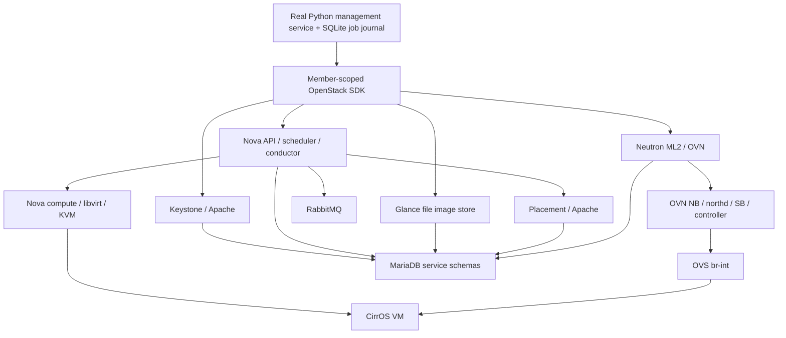

# Task 11 — deployed architecture and operational closeout

Status on 2026-10-24: real core-cloud/application acceptance and temporary dependency cleanup passed in the operator terminal. Current operational observations, listener review, logrotate disposition and the retained guest CPU smoke test remain pending. This is a local POC, not staging or production acceptance. The [chronological host evidence](task11-live-deployment-evidence.md) and [application evidence](task11-application-integration.md) distinguish real results from offline tests.

## Actual architecture and release boundary

The existing Windows 11 laptop runs its existing Ubuntu 22.04 WSL2 distribution. Ubuntu Cloud Archive `jammy-updates/caracal` packages provide one controller/compute node; configuration was performed by the approved local scripts and operator commands. There is no DevStack checkout/deployment. The [supplied architecture image](architecture-diagram.png.jpeg) was reviewed together with the requirements: its H100, Proxmox-first, Kubernetes, payment and offsite-storage components do not describe this implementation. Nova is the selected compute path. No new distribution, computer, cloud provider or remote Git push was used.



The application service is an in-process Python library with a bounded worker and durable SQLite journal, not a deployed custom HTTP gateway or web portal. Keystone and Placement run under Apache mod_wsgi, so missing standalone `keystone.service`/`placement-api.service` units are expected. The fixture path remains simulated and separate.

Previously observed package versions are Nova 29.2.0, Neutron 24.1.0, Keystone 25.0.0, Glance 28.1.0, Placement 11.0.0, MariaDB 10.6.23, RabbitMQ 3.9.27, OVS 3.3.9 and OVN 24.03.6. The operational review records full currently installed package strings for these services, libvirt/QEMU, Apache and the SDK; it does not infer versions from the intended release.

OpenStack documents [Caracal packages for Ubuntu 22.04](https://docs.openstack.org/install-guide/environment-packages-ubuntu.html). The [upstream release index](https://releases.openstack.org/) currently labels Caracal **Unmaintained**. Canonical's [package lifecycle table](https://canonical.com/openstack/docs/latest/reference/release-cycle-and-supported-versions/#openstack-packages) lists UCA 2024.1 standard EOL as April 2027 and distinguishes package maintenance from full support for third-party deployments. This manual WSL POC is not a vendor-validated deployment. Package availability does not certify WSL support or provide a production upgrade guarantee. Ubuntu remains 22.04; future upgrades need their own asset/backup/package review.

| Service | Configured catalog URL | Implementation |
| --- | --- | --- |
| Keystone | `http://127.0.0.1:5000/v3` | Apache mod_wsgi / MariaDB |
| Glance | `http://127.0.0.1:9292` | Glance API / protected file store / MariaDB |
| Placement | `http://127.0.0.1:8778` | Apache mod_wsgi / MariaDB |
| Nova | `http://127.0.0.1:8774/v2.1` | API/conductor/scheduler/compute, cells v2, RabbitMQ, Placement, KVM/libvirt |
| Neutron | `http://127.0.0.1:9696` | ML2/OVN, port security and OVN metadata agent |

Catalog loopback URLs do not prove loopback listener bindings. OVN NB/SB TCP listeners were explicitly verified on `127.0.0.1:6641/6642`. Nova/Neutron were configured to loopback. Earlier Apache, Glance and RabbitMQ output included wildcard listeners; current bindings and global Apache aliases still need review. These HTTP URLs use no TLS and are appropriate only within the deliberately restricted local access boundary. No claim of internet isolation follows from WSL NAT alone.

## Verified acceptance and preserved demo

| Journey | Actual evidence | Boundary |
| --- | --- | --- |
| Identity/projects/roles | Admin and service authentication; two member projects' own-resource access and denied/hidden foreign access | Temporary members/projects now removed; not a full Keystone policy audit |
| Image and catalog | Pinned-source CirrOS upload, active private images; tenant image secure hashes and downloaded SHA256; actual API catalog | Cinder/storage entries remain unavailable; no invented capacity |
| Compute | Real Nova create/inspect, actual KVM/QMP; direct stop/start/soft reboot with changed guest boot ID and recovered guest | One WSL compute host; no HA, live migration or GPU passthrough proof |
| Networking | DHCP/IP/MAC/MTU, pinned-key SSH, instance metadata, MTU-sized DF ping; three fresh denied TCP/22 connections with ICMP control and rule restoration | Metadata-namespace access, MTU 1442; no external router/floating IP or internet test |
| Project boundaries | Member-scoped API denial/filtering and other-project token rejection; two networks' positive ARP controls and no cross-network ARP replies | Bounded ARP path, not all protocols/multi-host/hostile tenants |
| Real application | Create/inspect and stop/start/delete through real SDK jobs with observed provider completion, durable duplicate lookup and independent host cleanup | In-process application service; uncertain operations require reconciliation |
| VM deletion | Operator Nova/Neutron absence, no libvirt domain/source disk, empty Placement allocations and zero temporary tenant compute usage | A retained recovery copy is not a leaked live VM allocation |
| Dependencies | All original temporary dependencies/users/projects absent; supplemental default group absent; selected OVN switches/namespaces removed | Original demo assets and historical infrastructure retained |
| CPU workload | Operational review prepared: arithmetic sum inside retained guest using pinned-key SSH | Live execution pending; not AI inference or a performance benchmark |

Original demo VM `82382430-4b64-4386-a55b-8468e04da011` remains `ACTIVE` after cleanup, on private network `6ee5ad82-efc5-405d-bf5c-a4953e9a063b`, subnet `172.30.240.0/24`, guest `172.30.240.154`, metadata source `172.30.240.2`. Its base image is `da953e4e-38ca-47d2-b97a-b62d3f33646a`. Its remaining flavor/key/group/port IDs are retained in root-only `run.json`. The local probe rules permit only TCP/22 and ICMP from the metadata address `/32`. The app VM and both temporary project networks are deleted; old application acceptance commands must not be replayed.

Temporary cleanup completed with supplemental recovery bundle `/root/openstack-poc-acceptance/dependency-recovery-b0a2694420364856a755347a048ea36a-eiocsu57`. The operator verified the reviewed recreated default-group removal, both empty task network inventories, both user/project removals and final OVN/namespace absence. This result supersedes the earlier partial-cleanup entries; the history is preserved for incident traceability.

## Current operations review command

```bash
sudo /usr/bin/python3 -B /home/sneha/projects/openstack-cloud-poc/scripts/local-openstack/review_operations.py
```

The [review script](../../scripts/local-openstack/review_operations.py) observes named systemd units, exact package versions, selected TCP/UDP listener bindings, Linux memory/disk and mounted Windows C: capacity when available. It authenticates through the existing protected operator credentials, checks the retained image/VM/network/port/flavor, current Nova/OVN health and matching Placement inventory, and returns credential-free catalog endpoints. It checks logrotate configuration hashes, bounded-call flags and parser debug mode; it does not execute postrotate hooks, rotate logs, reset failed units or enable the timer.

The script runs one bounded guest `awk` arithmetic command over the existing private key and existing pinned SSH trust with `StrictHostKeyChecking=yes`. It requires the exact result `5000050000` for the sum of 1 through 100000. It changes no VM, network, service, guest file or trust entry. The only intended persistent write is a new 0600 report under the existing 0700 root acceptance directory, named `operations-review-<unique UUID>.json`; old reports/manifests/backups are retained. No tokens, passwords, environment values or configuration contents are printed. Failed observations report only their error class, and collection completion does not imply operational acceptance.

Systemd observation `PASS` means the properties were read; required active units also have an explicit `expected_profile_match` flag. Inactive `logrotate.timer`, idle `logrotate.service` and intentionally inactive VTEP are reported without inventing a service failure. Listener `loopback=false` identifies a binding that needs review; it does not establish Windows/LAN/internet reachability. SSH/workload success is separate from systemd state.

Review results before listener changes or timer reactivation. Current local configuration inspection found OVN `ovs-appctl --timeout=5` but unbounded calls in the OVS logrotate hook. The earlier OVN hook validation remains valid for its observed time; a debug parse does not establish current hook runtime. Keep the timer stopped until safe current runtime validation and the remaining bound/timeout review are complete. Changes to shared Apache or historical uWSGI routes must preserve unrelated applications.

## Starting and pausing this POC

These are prepared manual operating instructions, not evidence that a full service pause/resume or WSL restart was tested. Real per-VM stop/start and soft reboot already passed. Use the protected SDK configuration; do not print/source credentials into shell history. After an actual WSL restart, compare current `eth0` addressing with the configured `172.19.169.140` before allowing workloads; do not blindly rerun deployment scripts against retained VMs. KVM oneshot enablement is verified, restart persistence remains untested.

To stop only the retained demo VM while control APIs are running:

```bash
sudo /usr/bin/python3 -B - <<'PY'
import logging, sys
sys.path.insert(0, '/home/sneha/projects/openstack-cloud-poc/scripts/local-openstack')
import configure_nova as common, launch_test_vm as launch, validate_guest as guest
logging.disable(logging.CRITICAL)
with common.connection(common.read_secrets(common.SECRET_FILE)) as cloud:
    state, _ = guest.load_run(cloud, require_ssh=False)
    server = cloud.compute.get_server(state['ids']['server'])
    launch.assert_owned(server, state, '', server=True)
    if server.task_state is not None or server.status not in ('ACTIVE', 'SHUTOFF'):
        raise SystemExit('Unexpected VM state; preserve it for review')
    if server.status == 'ACTIVE':
        cloud.compute.stop_server(server)
    server = cloud.compute.wait_for_server(server, status='SHUTOFF', failures=['ERROR'], interval=2, wait=150)
    print('Retained demo:', server.id, server.status)
PY
```

After stopping the demo and confirming no other users/jobs depend on these dedicated POC workers, they can be paused with:

```bash
sudo systemctl stop nova-compute nova-scheduler nova-conductor nova-api neutron-server neutron-ovn-metadata-agent glance-api
```

Shared Apache, MariaDB, RabbitMQ, libvirt, OVS and OVN continue to serve the existing host infrastructure. This pause is not a host shutdown or a claim that Keystone/Placement HTTP endpoints are stopped. Do not stop shared services, the WSL distribution or unrelated units as an automatic cleanup step.

To resume the dedicated POC workers when shared dependencies are healthy:

```bash
sudo systemctl start glance-api neutron-server neutron-ovn-metadata-agent nova-api nova-conductor nova-scheduler nova-compute
```

Then start only the retained demo:

```bash
sudo /usr/bin/python3 -B - <<'PY'
import logging, sys
sys.path.insert(0, '/home/sneha/projects/openstack-cloud-poc/scripts/local-openstack')
import configure_nova as common, launch_test_vm as launch, validate_guest as guest
logging.disable(logging.CRITICAL)
with common.connection(common.read_secrets(common.SECRET_FILE)) as cloud:
    state, _ = guest.load_run(cloud, require_ssh=False)
    server = cloud.compute.get_server(state['ids']['server'])
    launch.assert_owned(server, state, '', server=True)
    if server.task_state is not None or server.status not in ('SHUTOFF', 'ACTIVE'):
        raise SystemExit('Unexpected VM state; preserve it for review')
    if server.status == 'SHUTOFF':
        cloud.compute.start_server(server)
    server = cloud.compute.wait_for_server(server, status='ACTIVE', failures=['ERROR'], interval=2, wait=150)
    print('Retained demo:', server.id, server.status)
PY
```

Rerun the operations review to observe current service/guest behavior. A Nova state alone does not prove SSH, DHCP, metadata or workload recovery. These instructions create/delete no resource and do not change networking; they require the normal operator's sudo authentication. Do not use old creation/cleanup scripts as ordinary startup commands.

## Backups and remaining limitations

- Pre-Caracal protected inventory/data/configuration: `/home/sneha/openstack-poc-pre-caracal-20261024-150119`.
- App VM offline disk/domain/SQL/SQLite/live OVSDB/configuration recovery: `/root/openstack-poc-acceptance/recovery-db0d12b8-3bf4-4e53-9a63-4bbea9971831-lu4cuzr1`.
- Pre-dependency snapshot: `/root/openstack-poc-acceptance/dependency-recovery-b0a2694420364856a755347a048ea36a-wfk7feoy`.
- Supplemental default-group snapshot: `/root/openstack-poc-acceptance/dependency-recovery-b0a2694420364856a755347a048ea36a-eiocsu57`.

Integrity checks passed for these points at their recorded stages. Full service/database restore and guest boot from the recovery disk have not been rehearsed; this is the explicit restore limitation, not disaster-recovery acceptance. Sequential consistent SQL/OVSDB snapshots are not one distributed transaction. Prefer a separately scoped new-image/new-UUID recovery; whole-cloud rollback requires write quiescence, compatible schemas and preservation of newer state. Follow the protected `RECOVERY.md` and [backup procedure](task11-ovs-ovn-backup-procedure.md); never overwrite live databases or an existing VM disk. These backups share the laptop's failure domain; offsite/bare-metal recovery is not implemented.

The broader requirements retain fixture-labelled usage/reporting and historical billing/metering data, which were preserved under `/home/stack`. Real commercial metering, price reconciliation/payment processing, Ceilometer/Gnocchi/CloudKitty, monitoring dashboards, Horizon, Cinder/Swift, provider/external networks, floating IPs, GPU/MIG, pretrained AI inference, Kubernetes and external integrations are not established by this core deployment. They must remain unavailable/deferred or explicitly simulated rather than being called complete. No storage/AI/dashboard success is inferred from the Nova/Neutron tests. Staging target selection and production/data-center design remain separate.

The historical task/requirements files include predeployment fixture results and user-owned uncommitted changes. This record maps the current real implementation without staging or rewriting those unrelated changes. Master authorization supersedes their older per-task/push gates: local commits are authorized, remote push is not.

Relevant local milestones: `eef0cbf` Nova configuration, `58cee64` Neutron/OVN, `7c5a411` real VM stage, `6e865ab` policy, `b651913` lifecycle, `35237a9` tenant isolation, `b95bc74` real SDK/durable jobs, `105ef4b` guest/ARP stage, `18d623b` backup/lifecycle deletion, `0af43e9` dependency cleanup, `7afdf99` keypair error handling, `9fe793a` non-mutating inventory, `2bdaf8c` exact supplemental group. These commits implement/test the stages; operator output establishes live success. No remote push was performed.

Closeout is pending until the new operational report is reviewed, material listener findings and logrotate disposition are handled, and the final report distinguishes every remaining limitation. Do not mark all requirements complete merely because the core VM/API/network acceptance passed.

Workspace verification: all **362 offline tests** passed. Six added safeguards cover wildcard/IPv6/loopback listener classification, sensitive exception suppression, package metadata validation, inactive-service health truthfulness, pinned SSH/exact workload results, and execution of the arithmetic command in a local shell. That last test is a host command test, not guest/cloud evidence. The non-root execution guard and whitespace checks passed. Current host operational observations and the actual guest arithmetic result await the normal-terminal command above.
