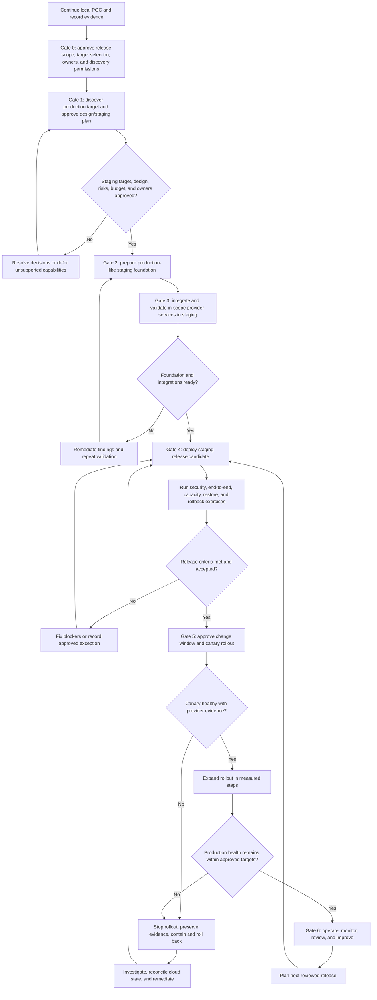

# Staging Release Plan

**Status:** Planning baseline; local OpenStack POC is the active development scope; staging target, scope, and owners are not yet selected or approved
**Delivery path:** Continue the local POC, carry its evidence into a separate staging validation, then promote only after staging acceptance and production approval
**Purpose:** Connect the original local POC requirements and evidence to a distinct staging release process and the long-term data-center production direction.

The original local OpenStack management POC is in scope and contributes requirements, architecture, implementation, and acceptance evidence to this plan. It is not the staging environment, and completing local work does not automatically pass any staging gate. The local implementation includes both real OpenStack-backed core workflows and a separate simulated fixture path. The operator-verified local evidence for Keystone, Glance, Placement, Nova, Neutron, guest isolation, recovery and WSL restart is recorded in Task 11; every staging target and capability must be validated independently. The laptop/WSL2 setup is neither staging nor production.

**Project scope decision:** Local OpenStack POC work is the current development path. AWS-hosted OpenStack and AWS-native EC2 tenant provisioning are not approved implementation paths and are not staging prerequisites. The staging target remains unselected. The long-term production direction is OpenStack on organization-owned physical data-center infrastructure; Nova is the chosen tenant compute path and Proxmox is deprecated. The deferred Option A design and Gate 1 package are retained only as historical architectural evaluations, not as mandatory release steps.

## Release outcome

Release a cloud management service for an explicitly approved workload and user population, backed by an approved and verified staging environment. The local POC provides design and implementation evidence; staging must independently validate real provider behavior, security, operations, and release criteria. Unsupported capabilities must remain unavailable and must not be advertised as usable.

## Scope to settle before implementation

The release owner records and approves these decisions during Gate 0. Unknown values are blockers for staging design and production deployment, not defaults to infer from the architecture diagram.

| Decision | Decision/evidence to record |
|---|---|
| Product and users | Workloads, user groups, regions, data classification, tenant/project model, and service owner |
| Cloud target | Select and approve a staging environment independently of the local POC; identify operator, distribution, supported release, endpoints, service inventory, support contract, feasibility evidence, and approvers. AWS-hosted OpenStack and AWS-native tenant provisioning are outside current scope. Production direction remains organization-owned data-center infrastructure running OpenStack. |
| VM manager | Nova is the chosen tenant compute path; Proxmox is deprecated. Confirm Nova support and configuration with the approved OpenStack operator. The supplied diagram’s Proxmox-first wording is historical and does not change this decision. |
| Service catalog | Exact approved images, flavors, networks, storage classes, quotas, regions, and capability status backed by provider data |
| Reliability | Availability target, maintenance windows, recovery objectives, backup retention, support hours, escalation path, and service ownership |
| Security and compliance | Data residency, identity/MFA/federation, audit retention, encryption, vulnerability response, and applicable regulatory obligations |
| GPU and external services | Whether GPU, object storage, Kubernetes, metering, billing, WAF, or external identity are in release scope; each requires verified support and a named owner |
| Capacity and cost | Forecast demand, quotas, headroom, cost limits, and who approves capacity changes |

No production timeline, SLA, capacity, or compliance claim is set by this document. The release owner adds these after discovery.

## Release gates

### Gate 0 — Production target and scope approved

**Entry:** Continue the local POC and begin release planning from the intended production use case. Record which POC requirements and artifacts exist, their evidence status, and which gaps need staging validation. POC completion is not implied by this gate, and a local demonstration does not pass staging acceptance.

**Work:** Name product, cloud, security, and operations owners. Define workload/users, data classification, staging target and deployment model, in-scope services, access boundaries, reliability objectives, capacity, budget, and approval process. Record the local POC baseline and evidence gaps. Obtain authorization for any read-only endpoint discovery or cloud operation before performing it.

**Evidence required:** Approved scope and decision record; target cloud and operator identified; production/staging access and change-control process; list of verified facts, estimates, and unknowns; initial risks and acceptance criteria.

**Exit:** Owners approve discovery/design work and its read-only or mutation scope. This gate does not authorize resource changes unless the approval explicitly names them.

### Gate 1 — Production design and staging plan approved

**Work:** Select and approve a staging environment independent of the local POC. Use the POC evidence crosswalk to distinguish locally proven behavior from simulated, unverified, blocked, or staging-only validation. Confirm the selected environment's service versions, API support, network boundaries, identity model, quotas, backend health, and operator responsibilities. Define how the staging architecture supports the data-center production direction and document environment differences, threat model, data flows, SLOs, capacity, and cost controls. AWS-hosted OpenStack feasibility is deferred and is not a Gate 1 requirement under the current scope decision. The [Option A Gate 1 package](architecture/option-a-gate1-feasibility-package.md) remains historical evaluation material only.

**Evidence required:** Approved target environment and provider support matrix; architecture and data-flow diagrams; service and API compatibility matrix; threat model; risk/decision register; deployment and rollback design; observability, backup, and support plans; prioritized production backlog and acceptance criteria.

**Exit:** Named approvers accept scope, architecture, risks, budget, and operating ownership. Any required capability that cannot be verified is excluded or blocks the release.

### Gate 2 — Staging foundation ready

**Work:** Provision an isolated, production-like staging environment using repeatable deployment automation. Establish secret management, TLS/certificate handling, network policy, identity integration, durable application state and job execution only where required, audit logging, monitoring, backups, alerting, and access procedures. Keep OpenStack service databases private and use supported APIs. Match production topology and controls closely enough that staging evidence is relevant; document intentional differences.

**Evidence required:** Infrastructure/deployment review; least-privilege access review; secret rotation procedure; restore evidence; capacity baseline; vulnerability and dependency review; log redaction check; operator runbooks; environment separation and change-control records.

**Exit:** Platform and security owners sign off the foundation and approve application integration work in staging.

### Gate 3 — Integrations and service behavior validated in staging

**Work:** Replace fixture paths for each in-scope capability with supported provider integrations. Implement and validate real Keystone authentication/authorization and project isolation; catalog discovery; Nova lifecycle; Neutron policy and reachability; Cinder/other storage only if selected; idempotency and durable job lifecycle for asynchronous operations; quotas and safe failure handling. Keep provider actions scoped and auditable. Use a dedicated staging project and staging-owned resources for integration exercises.

**Evidence required:** Integration test results against a dedicated non-production cloud/project; real provider evidence for resource state transitions; negative authorization and cross-project isolation cases; retry, timeout, duplicate-request, partial-failure, and reconciliation behavior; proof that unavailable services fail closed; provenance for every catalog and status field.

**Exit:** Product and cloud operators accept each in-scope capability. Fixture tests remain useful for local development but do not substitute for staging results.

### Gate 4 — Staging release candidate accepted

**Work:** Deploy the release candidate through the production deployment path. Run end-to-end user journeys and operational exercises with production-like identity, networking, quotas, load, and alerting. Complete security review and any scoped penetration testing under explicit authorization. Test upgrade, rollback, restore, and incident procedures.

**Evidence required:** Candidate version and immutable artifact identifiers; end-to-end results; load/capacity results against agreed targets; security findings with disposition; backup restore and rollback results; dashboards/alerts validated against real sources; change record; user/operator acceptance; release notes and known limitations.

**Exit:** No unresolved release-blocking security, data integrity, authorization, or reliability issues. All deviations have an owner, mitigation, and explicit acceptance.

### Gate 5 — Controlled production rollout

**Work:** Approve a change window and communication plan. Deploy to a limited cohort or canary scope; verify health and real cloud state; expand in measured steps. Freeze unrelated changes during rollout and record the exact artifact/configuration version. Do not expose a public endpoint unless the approved design requires and protects it.

**Go/no-go checks:**

- Correct artifact, configuration, secrets, certificates, and target environment verified.
- Health checks, authentication, project isolation, audit events, provider connectivity, and critical alerts pass.
- Canary workflows complete with matching provider evidence and no unexpected resource creation.
- On-call owner, cloud operator, escalation contacts, and rollback authority are present.

**Exit:** Release owner records rollout outcome, scope, evidence, incidents, and remaining actions.

### Gate 6 — Operate and improve

**Work:** Review service health, capacity, security findings, incidents, failed jobs, orphaned resources, cost/usage source quality, and user feedback. Patch dependencies and provider integrations through reviewed releases. Reassess support and capacity assumptions after material cloud or workload changes.

**Evidence required:** Operational review cadence; SLO and alert reports; incident/post-incident records; access and secret review; tested backup/restore schedule; capacity and cost reports with named sources; upgrade and end-of-support tracking.

## Staging-to-production release flow

## Production release acceptance criteria

All applicable criteria must be met or an explicitly named approver must accept a documented exception before rollout.

- The production target and every released capability are approved, supported, and backed by verified provider evidence.
- No fixture identity, fixture catalog, synthetic job, or simulated resource result is exposed as a real production result.
- Authentication, least privilege, project isolation, secret handling, TLS, auditability, and data retention meet the approved security design.
- Provisioning has defined idempotency, durable job state where asynchronous, safe retries, timeout handling, reconciliation, and cleanup ownership.
- Catalog, quota, capacity, usage, and health data identify their source, freshness, and unavailable state. No unsupported GPU, H100/MIG, billing, or capacity claim is made.
- Monitoring and alerts cover user-visible failures, provider/API failures, job backlog/stalls, authorization failures, capacity thresholds, and backup failures as applicable.
- Backup restore, deployment rollback, incident response, and operator runbooks have been exercised in a non-production environment.
- Staging acceptance, change approval, release notes, known limitations, support contacts, and rollback decision authority are recorded.

## Rollback and incident handling

The release-specific runbook must name the decision-maker and exact rollback steps. At minimum, stop rollout and contain access if authorization, isolation, data integrity, unexpected resource creation, secret exposure, or critical service health is in question. Preserve audit evidence. Revert to the last known-good application artifact/configuration using the tested procedure; do not blindly reverse cloud resources or delete user resources. Reconcile provider state before retrying operations. Cloud resource cleanup requires explicit scope and ownership and must never use a broad delete/destroy action against shared infrastructure.

## Ownership and approval record

Before Gate 1 exits, populate the following in the release tracking record:

- Product/release owner:
- Cloud/platform operator:
- Security approver:
- Operations/on-call owner:
- User acceptance owner:
- Target environment and release scope:
- Approved SLOs and recovery objectives:
- Rollout window and rollback authority:
- Exceptions accepted, approver, and expiry/review date:

## Local POC to staging evidence crosswalk

The local POC produces evidence for planning and local acceptance. Task 11 includes real operator-verified Nova/Neutron lifecycle, guest isolation, recovery and WSL restart results in addition to separate fixture tests. Staging independently validates provider behavior and environment-specific controls. A fixture result proves only that the local implementation handled a simulated case.

| Capability / original requirement | Local POC source and evidence | What remains for staging |
|---|---|---|
| Identity, roles, project isolation (requirements §3 Layer 1; POC-005, POC-023) | T06/T11 plus Task 11 live authenticated API/tenant isolation results; unit fixtures remain simulated | Validate actual staging Keystone authentication, role enforcement, negative authorization, and cross-project isolation |
| Catalog and capability provenance (POC-010, POC-014) | T08/T09/T10; fixture catalog and status reporting in `openstack_cloud_poc/catalog*.py`, `adapter.py`, and `capabilities.py` | Compare catalog and capability claims with real staging APIs and capacity |
| Provisioning contract and synchronous handling (requirements §3 Layer 3; POC-015/016) | T12/T13 and Task 11 real SDK application integration; the contract/fixture implementation remains separate | Validate provider integration, real provider state, authorization, errors, and idempotency against staging |
| Job status and long-running operations (POC-017) | T14 plus Task 11 durable SQLite job/phase/idempotency evidence for the local SDK path; `tests/test_async_lifecycle.py` separately covers fixtures | Validate the staging execution mechanism, durable job state, retries, reconciliation, failure handling, and real identity/authorization behavior |
| Nova instance lifecycle (requirements §3 Layer 4; POC-008/011) | Task 11 real Nova create/inspect/start/stop/delete and Nova-issued identifiers; Task 3/4 fixture tests remain simulated | Validate Nova lifecycle and identifiers against the separately approved staging cloud |
| Neutron networking and isolation (POC-007/013) | Task 11 real Neutron binding, DHCP/metadata, guest connectivity, packet isolation and cleanup; `tests/test_network_policy.py` separately tests fixture policy | Validate the staging path, security groups, routing, guest connectivity, and cross-tenant isolation |
| Storage, usage, operations, and recovery (POC-012, POC-018/019/020/024) | T18/T19/T20/T21/T26/T27 records; local Cinder/Swift backends and integrated metering/monitoring remain unavailable; T20/T21 fixture summaries are simulated, unpriced, non-billing. T27 isolated restore and WSL restart passed, while full-cloud/offsite recovery did not. | Validate staging backends and real metering/monitoring sources, plus backup/restore procedures; any staging pricing needs its own approved policy |
| GPU feasibility and sample workload (POC-021/022) | T23's existing audit shows RTX 2060 visibility inside a CUDA container; host NVML failed and Nova guest passthrough is unverified. No T24 workload was run. | GPU remains optional; if included, staging must validate the selected hardware, passthrough/isolation model, workload, and resource limits independently |
| End-to-end acceptance (POC-025) | Task 11 real local lifecycle, guest/network/isolation, cleanup, backup restore and restart evidence; separate fixture demonstration remains simulated | Run staging release acceptance with real provider evidence, security/operations checks, cleanup, and release-owner sign-off |

Task 11's operator reports establish the recorded local provider results; offline test files establish code-path and fixture behavior only. The current suite at the WSL manager verification point discovered **496 tests: 494 passed, 2 opt-in daemon tests skipped**. No staging tests were run.

## Relationship to existing repository documents

- [`../requirements/requirements-specification.md`](requirements/requirements-specification.md) retains the original local POC requirements and acceptance criteria; it is the source for local POC scope and capability definitions.
- [`docs/tasks/README.md`](tasks/README.md) preserves the original POC task IDs, implementation history, and acceptance evidence. The IDs are not silently reactivated as a sequence; task selection remains scoped and explicit.
- [`architecture/architecture-diagram.png.jpeg`](architecture/architecture-diagram.png.jpeg), [`architecture/openstack-service-mapping.md`](architecture/openstack-service-mapping.md), and [`architecture/architecture-gaps.md`](architecture/architecture-gaps.md) preserve the original visual architecture, service mapping, and unresolved discrepancies. Diagram contents are design input, not deployment evidence.
- [`architecture/ProjectDeliveryflow.md`](architecture/ProjectDeliveryflow.md) records the original POC workflow and fixture implementation boundaries for traceability.
- [`architecture/option-a-technical-reference-design.md`](architecture/option-a-technical-reference-design.md) and [`architecture/option-a-gate1-feasibility-package.md`](architecture/option-a-gate1-feasibility-package.md) are deferred/historical AWS-hosted OpenStack evaluations, not required implementation steps.
- [`architecture-gaps.md`](architecture/architecture-gaps.md) tracks unresolved source discrepancies and decisions; resolve production-relevant ones at Gate 0 or Gate 1.
- [`environment-audit.md`](architecture/environment-audit.md) is a point-in-time laptop audit, not a production capacity or cloud inventory assessment.
- [`openstack-service-mapping.md`](architecture/openstack-service-mapping.md) describes intended mappings and conditional integrations, not verified production support.
- [`provisioning-contract.md`](api/provisioning-contract.md) defines validation/evidence semantics and a local process-bound executor; it does not establish a deployed HTTP API, durable/external queue, or provider integration.
